# 미션 E1-1 — 개발 환경 구축 전체 수행 절차 및 결과 보고서

**과제명:** 내 컴퓨터에 개발자용 ‘작업실’ 꾸미기  
**수행일:** 2026년 11월 23일 (신규 PC 실습·증빙 기준)  
**제출 저장소:** https://github.com/bigpark61/develop_environment  
**최종 Git Commit:** `c9a7f70` (`docs: complete E1-1 Docker and Linux mission evidence`)  
**작성 목적:** 과제 요구사항, 단계별 지시, 실제 수행 명령어, 결과와 해석, 오류 해결, 증빙 화면을 **하나의 Markdown 보고서**로 통합

> **이미지 표시 방식:** 이 보고서와 같은 위치의 `images/` 폴더에 실제 증빙 PNG 16개를 저장하고 이미지 상대경로로 연결했다. 상대경로로 연결했다. ZIP을 통째로 압축 해제하고 폴더 구조를 유지하면 VSCode Markdown 미리보기 등에서 **인터넷 없이 이미지가 표시**된다.
>
> **사실 구분:** 2026-11-23 실습 결과는 이번 대화에서 제출한 실제 화면으로 확인하였다. `Logs_01.md`, `Logs_02.md` 및 기존 이미지의 내용은 앞선 환경에서 수행한 기록으로 구분하였다. 실행하지 않은 출력은 반드시 `예상`으로 표기한다.

## 1. 과제 목적, 요구사항 및 제출 기준

이 미션은 Windows/WSL Ubuntu 환경에서 Linux CLI와 파일 권한을 다루고, Docker로 이미지·컨테이너·포트 매핑·Bind Mount·Volume을 검증한 뒤 Git/GitHub와 README로 모든 결과를 재현 가능하게 제출하는 과제다.

| 구분 | 과제 PDF 필수 요구사항 | 제출 증거 |
|---|---|---|
| 개발 환경 | OS/셸/터미널/Docker/Git 버전 | 환경 및 명령 로그 |
| Linux CLI | 현재 위치, 목록, 생성·복사·이동·이름 변경·삭제, 빈 파일/내용 확인 | 명령어+출력 |
| 권한 | 파일 1개와 디렉터리 1개 권한 변경 전후 | `chmod`, `ls -l`, `ls -ld` |
| Docker | 엔진 점검, 이미지/컨테이너/로그/자원 운영 | `docker info`, `images`, `ps`, `logs`, `stats` |
| 컨테이너 | hello-world 성공, Ubuntu 내부 명령 | 실제 컨테이너 출력 |
| 커스텀 이미지 | 직접 작성한 Dockerfile, 빌드·실행 | Dockerfile, HTML, 빌드 로그 |
| 포트 | 호스트→컨테이너 매핑 및 접속 | 브라우저 주소창과 응답 |
| Bind Mount | 호스트 수정 전/후 반영 비교 | `-v`, `curl` 비교 |
| Volume | 컨테이너 삭제 후 데이터 지속 확인 | 생성·쓰기·삭제·재조회 |
| Git | 사용자 설정, GitHub/VSCode 연동, 저장소 제출 | 설정·복제·Commit·Push |
| 기술 문서 | 개요·환경·체크리스트·검증 명령·출력·링크 | 본 보고서/README |
| 트러블슈팅 | 2건 이상 원인 가설→확인→조치→결과 | 아래 오류 분석 |

**선택(보너스):** Docker Compose, 다중 컨테이너, 환경 변수, GitHub SSH 키. 이 보고서에서는 필수 수행 결과 중심으로 기록한다.

## 2. 개발 환경과 실행 위치

| 구성 | 2026-11-23 이번 실습 확인 사항 |
|---|---|
| 호스트 | Windows 11, Windows PowerShell |
| WSL | `Ubuntu`, 상태 `Running`, `VERSION 2` |
| Ubuntu | Ubuntu 26.04.1 LTS (`resolute`) |
| Ubuntu 셸 | `/bin/bash` |
| Ubuntu 사용자 홈 | `/home/kyoungboopark4891` |
| Docker CLI/Engine | 29.9.3 |
| Docker Desktop | 4.99.0, Engine running |
| 프로젝트 원본 | `~/codyssey/dockerfile-web` |
| 권한 실습 | `~/codyssey/permission-practice` |
| WSL Git 저장소 | `~/codyssey/develop_environment` |
| Windows Git 작업 저장소 | `C:\Temp\develop_environment` |
| 제출 원격 | `https://github.com/bigpark61/develop_environment.git` |

> **작업 위치 구분:** Windows PowerShell에서는 `C:\...>` 프롬프트, WSL Ubuntu에서는 `사용자@호스트:~$`, Docker 컨테이너 내부에서는 `root@컨테이너ID:/#` 프롬프트가 나타났다. Docker 관리 명령은 Windows 또는 WSL 호스트에서 실행하며, Ubuntu 컨테이너 내부에는 Docker CLI가 기본으로 없었다.


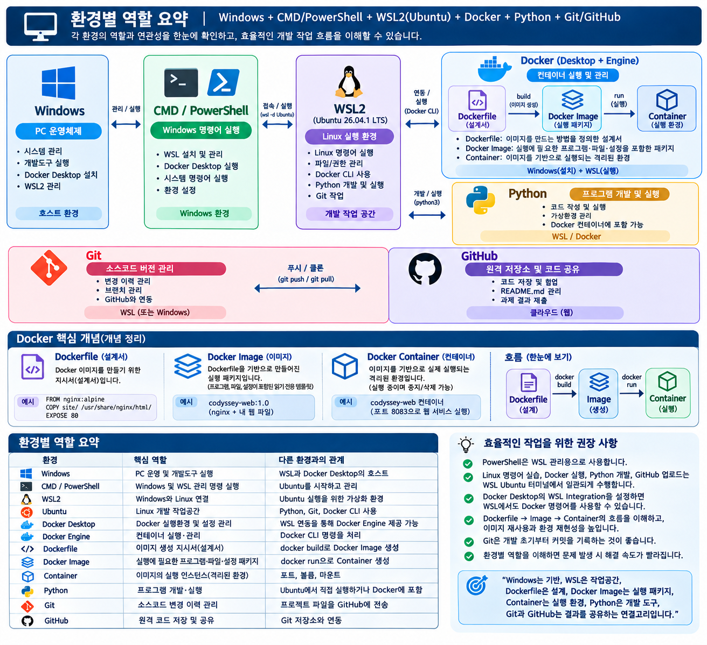

*그림: Windows·WSL Ubuntu·Docker·Git/GitHub 및 Dockerfile/Image/Container 관계 — GitHub 저장소에 업로드된 실제 증빙 이미지*


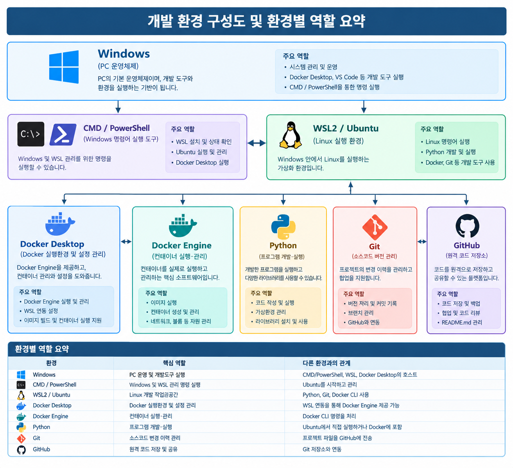

*그림: 개발 환경 구성도 — GitHub 저장소에 업로드된 실제 증빙 이미지*

## 3. 전체 수행 절차 일람

| STEP | 지시·수행 내용 | 확인된 핵심 결과 |
|---|---|---|
| 1 | WSL 설치 여부 확인 및 Ubuntu 설치 | 배포판 설치·사용자 생성 성공 |
| 2 | Ubuntu 버전·셸·홈 경로 확인 | 26.04.1 LTS, `/bin/bash`, 홈 이동 |
| 3 | WSL2 상태 확인 | `Ubuntu Running 2` |
| 4 | Docker CLI/Engine 상태 점검 | 초기 엔진 연결 실패, Desktop 실행 후 성공 |
| 5 | Docker Desktop WSL Integration | Ubuntu 연동 및 Server 29.9.3 확인 |
| 6 | `hello-world` 컨테이너 | 성공 메시지 출력 |
| 7 | Ubuntu 컨테이너 내부 실습·종료·재접속 | `pwd`, `ls`, `echo`, `start`, `exec`, `stop` |
| 8 | HTML·Dockerfile·커스텀 이미지 제작 | `codyssey-web:1.0` 빌드 |
| 9 | 웹 접속 및 Bind Mount | 8083 원본/8084 변경본 비교 |
| 10 | Docker Volume 영속성 | 컨테이너 삭제 후 파일 유지 |
| 11 | Linux 파일·디렉터리 권한 | 파일 644→600, 디렉터리 755→700 |
| 12 | Docker 운영 상태·로그 | images/ps/logs/stats 출력 |
| 13 | GitHub 복제 및 파일·증빙 정리 | Dockerfile/HTML/증빙 6개 추가 |
| 14 | README 갱신 및 Git Commit | 작성자 정보 오류 해결, Commit 생성 |
| 15 | GitHub Push·최종 확인 | `c9a7f70`, `main -> main` |

---

## 4. STEP 1~3 — WSL Ubuntu 설치 및 환경 확인

### 4.1 목적과 지시

Windows 위에서 Linux 개발 환경을 구성한다. 먼저 Windows PowerShell에서 배포판 설치 여부를 확인하고, 없으면 Ubuntu를 설치하며, 최초 실행 시 Unix 사용자 계정을 설정한다.

```powershell
wsl --list --verbose
wsl --install
# 설치 후 초기 실행
wsl -d Ubuntu
```

**실제 결과:** 최초 `wsl --list --verbose`에서는 설치된 배포판이 없다고 나왔고, `wsl --install`로 Ubuntu를 다운로드·설치했다. Unix 사용자 계정 생성과 비밀번호 설정에서 `password updated successfully`가 표시되었으며 Ubuntu Shell에 진입했다.

### 4.2 Ubuntu 내부 확인 지시 및 결과

```bash
lsb_release -a
# Distributor ID: Ubuntu
# Description: Ubuntu 26.04.1 LTS
# Release: 26.04
# Codename: resolute

echo $SHELL
# /bin/bash

cd ~
pwd
# /home/kyoungboopark4891
```

`No LSB modules are available.`라는 메시지도 보였으나 버전 조회 자체는 정상 성공했다. 처음 경로 `/mnt/c/Users/...`는 Windows C 드라이브를 Linux에서 접근한 위치이며, 이후 과제 작업은 Ubuntu 홈의 `~/codyssey` 아래에서 진행했다.

Windows PowerShell에서 WSL 버전을 재확인했다.

```powershell
wsl --list --verbose
# NAME     STATE     VERSION
# Ubuntu   Running   2
```

**판정:** Ubuntu 설치, Bash 사용, 홈 디렉터리 이동, WSL2 확인 완료.

## 5. STEP 4~5 — Docker 설치·엔진·WSL Integration 검증

### 5.1 Docker CLI 확인 지시

```powershell
docker --version
# Docker version 29.9.3, build 5457199

docker info
```

처음 `docker info`에서는 Docker CLI 플러그인 정보는 보였지만 다음 오류가 발생했다.

```text
Server:
failed to connect to the docker API at npipe:////./pipe/docker_engine
The system cannot find the file specified.
```

**해석:** 명령어 자체는 설치되어 있었지만 당시 Docker Engine에 연결되지 않았다. 서버 데몬 초기화 전이나 Docker Desktop 미실행 등의 가능성이 있었으며 당시 정확한 원인을 화면만으로 단정하지 않았다.

### 5.2 해결 지시 및 결과

1. Windows 시작 메뉴에서 Docker Desktop 실행
2. 첫 실행 Welcome 화면의 설정 통과
3. Desktop 왼쪽 아래 `Engine running` 상태 확인
4. **Settings → WSL integration**에서 기본 WSL 통합 및 Ubuntu 연동 상태 확인
5. Ubuntu에서 다음 명령으로 Client/Server 연결 재확인

```bash
docker --version
# Docker version 29.9.3, build 5457199

docker info --format '{{.ServerVersion}}'
# 29.9.3
```

**판정:** 초기 Docker 연결 장애 해결, Ubuntu ↔ Docker Desktop 엔진 통신 검증 완료.


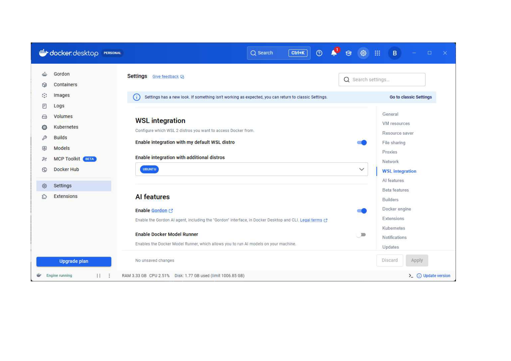

*그림: Docker Desktop과 WSL의 연동 설정 참고 캡처 — GitHub 저장소에 업로드된 실제 증빙 이미지*

## 6. STEP 6 — 첫 번째 Docker 컨테이너 실행

**지시:** 공식 테스트 이미지 `hello-world`를 실행한다.

```bash
docker run hello-world
```

**실제 핵심 출력:**

```text
Unable to find image 'hello-world:latest' locally
latest: Pulling from library/hello-world
Status: Downloaded newer image for hello-world:latest

Hello from Docker!
This message shows that your installation appears to be working correctly.
```

**해석:** 로컬 이미지가 없을 때 `Unable to find image ... locally`는 오류가 아니라 자동 다운로드 과정이다. 이미지 다운로드→컨테이너 생성→메시지 출력→정상 종료를 확인했다.

## 7. STEP 7 — Ubuntu 컨테이너 실행·내부 접속·상태 관리

### 7.1 Ubuntu 컨테이너 생성

```bash
cd ~
docker run -it --name ubuntu-lab ubuntu bash
```

컨테이너 내부 프롬프트는 `root@da00767e72ad:/#`로 표시됐다.

**지시:** 컨테이너 내부에서 Linux 명령을 실행한다.

```bash
pwd
# /
ls
# bin boot dev etc home lib ...
echo "Hello from Ubuntu Containers"
# Hello from Ubuntu Containers
```

### 7.2 컨테이너 종료 및 목록 확인

```bash
exit
docker ps
# 실행 중 컨테이너 없음

docker ps -a
# ubuntu-lab  Exited (0)
# hello-world Exited (0)
```

`docker ps`는 실행 중만, `docker ps -a`는 종료된 컨테이너도 표시한다.

### 7.3 기존 컨테이너 재실행 및 exec 접속

```bash
docker start ubuntu-lab
docker ps
# ubuntu-lab Up ...

docker exec -it ubuntu-lab bash
```

**실제 발생한 오류:**

```text
root@da00767e72ad:/# docker start ubuntu-lab
bash: docker: command not found
```

**원인·교훈:** `docker exec`로 이미 컨테이너 안에 들어간 상태에서 Docker 관리 명령을 실행했기 때문이다. 관리 명령은 WSL Ubuntu 호스트로 나온 뒤 실행한다. `exit`로 exec Bash만 종료한 후에도 `docker ps`에 `ubuntu-lab Up`이 표시되어 컨테이너가 살아 있음을 확인했다.

### 7.4 Docker stop 검증

```bash
docker stop ubuntu-lab
# ubuntu-lab
docker ps
# 실행 중 목록에 없음
docker ps -a
# ubuntu-lab Exited (137)
```

`Exited (137)`은 SIGKILL에 의한 종료를 나타낸다. `docker stop`이 우선 정상 종료를 시도하고 필요하면 강제 종료할 수 있으므로 이 출력만으로 특정 장애를 단정하지 않는다.

**판정:** Docker 컨테이너 생성·종료·재실행·exec 접속·상태 조회 수행.

## 8. STEP 8 — Dockerfile 및 커스텀 NGINX 이미지 제작

### 8.1 폴더 준비 지시와 실제 결과

```bash
mkdir -p ~/codyssey/dockerfile-web/site
cd ~/codyssey/dockerfile-web
pwd
# /home/kyoungboopark4891/codyssey/dockerfile-web
```

### 8.2 HTML 작성 지시

```bash
nano site/index.html
cat site/index.html
```

**실제 작성 소스 (`site/index.html`):**

```html
<!DOCTYPE html>
<html lang="ko">
<head>
    <meta charset="UTF-8">
    <title>Codyssey Docker Mission E1-1</title>
</head>
<body>
    <h1>Codyssey Docker Mission E1-1</h1>
    <h2>Custom Docker Image Test</h2>
    <p>Dockerfile을 이용하여 제작한 웹 서버입니다.</p>
    <p>WSL2 Ubuntu + Docker Desktop</p>
</body>
</html>
```

### 8.3 Dockerfile 작성 지시

```bash
nano Dockerfile
cat Dockerfile
ls -R
```

**실제 Dockerfile:**

```dockerfile
FROM nginx:alpine

LABEL org.opencontainers.image.title="codyssey-web"

COPY site/ /usr/share/nginx/html/

EXPOSE 80
```

| 명령어 | 개념 |
|---|---|
| `FROM nginx:alpine` | NGINX를 포함한 베이스 이미지를 사용 |
| `LABEL` | 이미지 이름 관련 메타데이터 기록 |
| `COPY` | 빌드 시 `site/` 파일을 이미지의 웹 루트로 복사 |
| `EXPOSE 80` | 컨테이너 80번 포트 사용을 문서화(외부 매핑 자체는 아님) |

**개념 요약:** Dockerfile(제작 지시서) → `docker build` → Image(읽기 전용 실행 패키지) → `docker run` → Container(실행 인스턴스).

### 8.4 커스텀 이미지 빌드

```bash
docker build -t codyssey-web:1.0 .
```

**실제 핵심 출력:**

```text
[+] Building 5.1s (8/8) FINISHED
[2/2] COPY site/ /usr/share/nginx/html/
naming to docker.io/library/codyssey-web:1.0
```


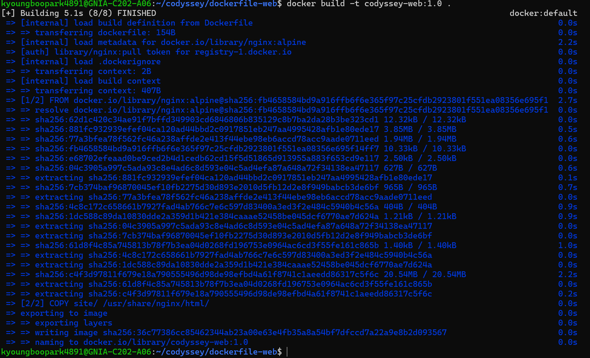

*그림: Dockerfile 빌드 성공 터미널 화면 — GitHub 저장소에 업로드된 실제 증빙 이미지*

### 8.5 커스텀 컨테이너 실행 및 웹 접속

```bash
docker run -d --name codyssey-web -p 8083:80 codyssey-web:1.0
docker ps
curl http://localhost:8083
```

Windows Chrome 브라우저에서 **`http://localhost:8083`** 접속에 성공했다. 화면에는 `Codyssey Docker Mission E1-1`, `Custom Docker Image Test`, 한글 웹 문구가 표시되었다.

**판정:** 직접 작성한 Dockerfile과 HTML로 이미지 빌드·컨테이너 실행·포트 매핑·브라우저 접속 모두 성공.


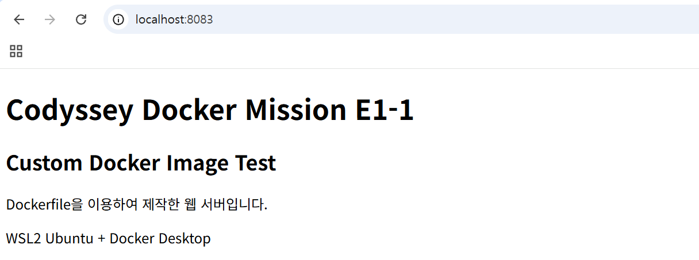

*그림: localhost:8083에서 커스텀 HTML 페이지 접속 성공 — GitHub 저장소에 업로드된 실제 증빙 이미지*

## 9. STEP 9 — Bind Mount 변경 즉시 반영 검증

### 9.1 개념 및 실행 지시

Dockerfile의 `COPY`는 **빌드 시점 파일**을 이미지에 포함한다. Bind Mount는 **호스트의 현재 파일**을 컨테이너에 연결한다.

```bash
cd ~/codyssey/dockerfile-web
docker run -d \
  --name codyssey-bind \
  -p 8084:80 \
  -v "$(pwd)/site:/usr/share/nginx/html:ro" \
  nginx:alpine

docker ps
curl http://localhost:8084
```

`ro`는 컨테이너 입장에서 읽기 전용이라는 의미이며, 호스트 Ubuntu에서는 파일을 수정할 수 있다.

### 9.2 HTML 문구 수정 지시

```bash
grep '<h2>' site/index.html
# <h2>Custom Docker Image Test</h2>

nano site/index.html
# <h2>를 다음 내용으로 변경
# <h2>Bind Mount Update Success!</h2>
```

### 9.3 변경 전후 실제 응답 비교

```bash
curl -s http://localhost:8084 | grep '<h2>'
# <h2>Bind Mount Update Success!</h2>

curl -s http://localhost:8083 | grep '<h2>'
# <h2>Custom Docker Image Test</h2>
```

| 주소 | 방식 | 실제 결과 |
|---|---|---|
| `localhost:8083` | Dockerfile COPY | 기존 문구 유지 |
| `localhost:8084` | Bind Mount | 변경 문구 즉시 반영 |

**판정:** `docker build` 또는 컨테이너 재시작 없이 Bind Mount 반영 성공. 동일한 실습으로 COPY와 Bind Mount 동작 차이를 입증했다.


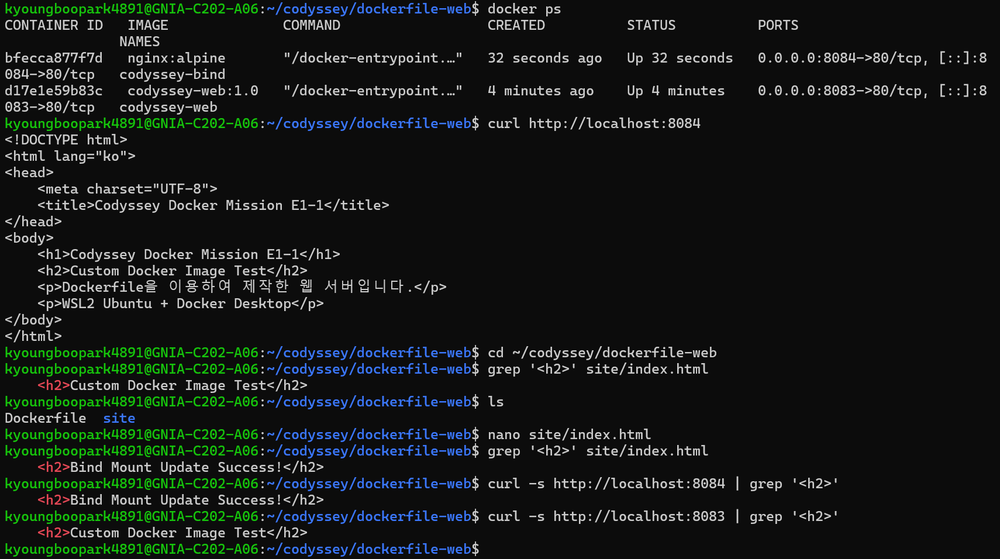

*그림: 8083과 8084 응답의 차이를 검증한 실제 화면 — GitHub 저장소에 업로드된 실제 증빙 이미지*

## 10. STEP 10 — Docker Volume 데이터 영속성 검증

### 10.1 볼륨 생성과 상세 조회

```bash
docker volume create codyssey-data
# codyssey-data

docker volume ls
# local codyssey-data

docker volume inspect codyssey-data
# Driver: local
# Mountpoint: /var/lib/docker/volumes/codyssey-data/_data
```

### 10.2 컨테이너 A에 데이터 작성

```bash
docker run -it \
  --name volume-test \
  -v codyssey-data:/data \
  ubuntu bash
```

컨테이너 내부에서:

```bash
echo "Docker Volume Persistence Test" > /data/test.txt
cat /data/test.txt
# Docker Volume Persistence Test
ls -l /data
# -rw-r--r-- ... test.txt
exit
```

### 10.3 기존 컨테이너 제거 후 새 컨테이너에서 재조회

```bash
docker rm volume-test
# volume-test

docker run --rm \
  --name volume-test2 \
  -v codyssey-data:/data \
  ubuntu cat /data/test.txt
# Docker Volume Persistence Test

docker volume ls
# local codyssey-data
```

**판정:** `volume-test` 컨테이너를 제거한 후 새로운 컨테이너에서 동일한 `test.txt` 문자열을 조회했다. 이름이 지정된 Docker Volume은 컨테이너와 독립적으로 데이터를 유지한다는 사실을 직접 검증했다.

> `docker volume rm codyssey-data` 또는 `docker volume prune`은 볼륨 데이터까지 삭제할 수 있으므로 실습 기록 보존을 위해 실행하지 않았다.


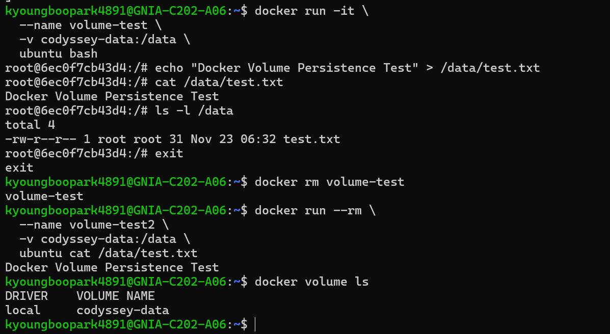

*그림: Docker Volume 생성·쓰기·컨테이너 삭제·재조회 성공 — GitHub 저장소에 업로드된 실제 증빙 이미지*

## 11. STEP 11 — 파일과 디렉터리 권한 변경 실습

### 11.1 파일·디렉터리 준비 지시

```bash
mkdir -p ~/codyssey/permission-practice/sample_dir
cd ~/codyssey/permission-practice
echo "Linux Permission Test" > test.txt
ls -l test.txt
ls -ld sample_dir
```

**변경 전 실제 권한:**

```text
-rw-r--r-- ... test.txt
drwxr-xr-x ... sample_dir
```

### 11.2 chmod 변경 및 검증

```bash
chmod 600 test.txt
chmod 700 sample_dir
ls -l test.txt
ls -ld sample_dir
```

**변경 후 실제 권한:**

```text
-rw------- ... test.txt
drwx------ ... sample_dir
```

| 대상 | 변경 전 | 변경 후 | 의미 |
|---|---|---|---|
| 파일 `test.txt` | 644 | 600 | 소유자만 읽기·쓰기 |
| 디렉터리 `sample_dir` | 755 | 700 | 소유자만 목록·쓰기·진입 |

`r=4`, `w=2`, `x=1`; 디렉터리의 `x`는 진입/경로 탐색 권한이라는 뜻이다.

**판정:** 과제 요구인 파일 1개와 디렉터리 1개 권한 변경 및 전후 비교 완료.


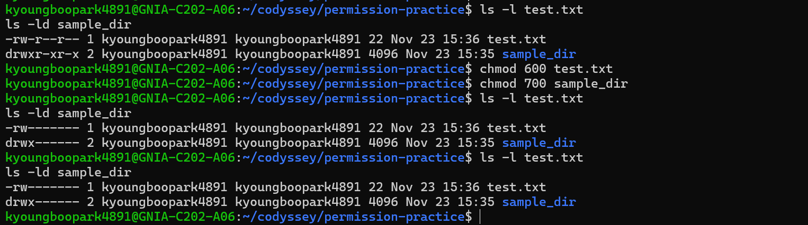

*그림: chmod 600/700 실행 전후 출력 비교 — GitHub 저장소에 업로드된 실제 증빙 이미지*

## 12. STEP 12 — Docker 운영 로그·자원 사용량 검증

```bash
docker ps -a
docker logs --tail 20 codyssey-web
docker stats --no-stream
docker images
```

### 12.1 실제 컨테이너 상태

| 컨테이너 | 이미지 | 확인 당시 상태 | 포트 |
|---|---|---|---|
| `codyssey-web` | `codyssey-web:1.0` | Up | 8083→80 |
| `codyssey-bind` | `nginx:alpine` | Up | 8084→80 |
| `ubuntu-lab` | `ubuntu` | Exited (137) | 없음 |
| hello-world 컨테이너 | `hello-world` | Exited (0) | 없음 |

### 12.2 NGINX 로그 해석

```text
"GET / HTTP/1.1" 200 335
"GET /favicon.ico HTTP/1.1" 404
```

- HTTP `200`: 웹 페이지 요청 처리 성공.
- `favicon.ico`에 대한 HTTP `404`: 브라우저가 요청한 아이콘 파일 부재. 메인 페이지의 실패가 아니다.

### 12.3 실제 자원 사용량(측정 시점)

| 컨테이너 | CPU | 메모리 사용량 |
|---|---:|---:|
| `codyssey-bind` | 0.00% | 18.42 MiB |
| `codyssey-web` | 0.00% | 18.48 MiB |

### 12.4 이미지 목록

`docker images` 결과에 다음 이미지가 확인되었다.

```text
codyssey-web:1.0
hello-world:latest
nginx:alpine
ubuntu:latest
```

**판정:** `images`, `ps -a`, `logs`, `stats` 실행 출력 확보 완료.


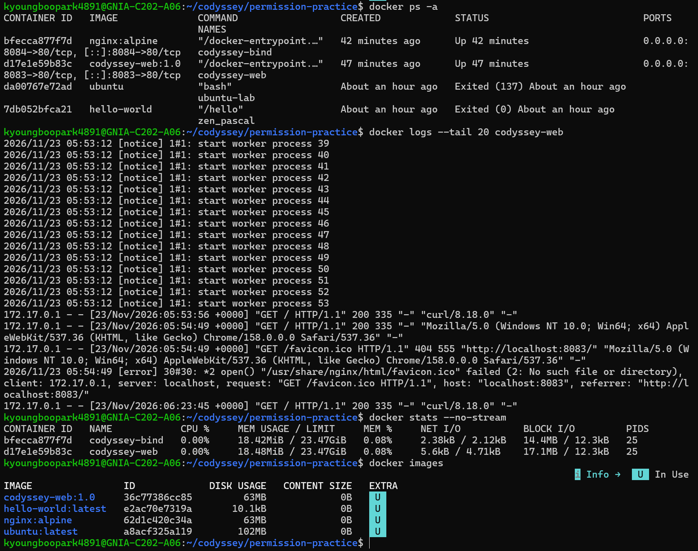

*그림: Docker 이미지·컨테이너·NGINX 로그·stats 확인 결과 — GitHub 저장소에 업로드된 실제 증빙 이미지*

## 13. STEP 13 — 기존 GitHub 저장소 복제·신규 파일·증빙 배치

### 13.1 기존 GitHub 저장소 Clone

처음 `~/codyssey`에는 `dockerfile-web/`, `permission-practice/`만 있었다. 따라서 기존 원격 저장소를 복제했다.

```bash
cd ~/codyssey
git clone https://github.com/bigpark61/develop_environment.git
# Receiving objects: 100% (44/44) ...
cd develop_environment
git remote -v
# origin https://github.com/bigpark61/develop_environment.git (fetch)
# origin https://github.com/bigpark61/develop_environment.git (push)
git status
# On branch main
# Your branch is up to date with 'origin/main'.
# nothing to commit, working tree clean
```

### 13.2 실습 파일을 제출 저장소로 복사

```bash
cd ~/codyssey/develop_environment
mkdir -p site
cp ../dockerfile-web/Dockerfile ./Dockerfile
cp ../dockerfile-web/site/index.html ./site/index.html
ls -l Dockerfile site/index.html
git status
# Untracked files: Dockerfile, site/
```

### 13.3 신규 증빙 PNG 6개 정리

ChatGPT 대화에 업로드된 실행 화면을 다운로드하여 기존 `evidence/` 폴더에 추가했다. 파일 탐색기에서 **기존 12개 + 신규 6개 = 총 18개 증빙 파일**이 확인됐다.

| 이미지 | 증명한 내용 |
|---|---|
| `dockerfile-build.png` | Docker 이미지 제작 성공 |
| `dockerfile-web-8083.png` | 포트 8083 커스텀 HTML 접속 |
| `bind-mount-verification.png` | 변경 전후 curl 출력 비교 |
| `docker-volume-persistence.png` | 컨테이너 삭제 뒤 파일 유지 |
| `linux-permission-change.png` | 파일·디렉터리 chmod 비교 |
| `docker-operations-final.png` | Docker 운영 로그·자원·이미지 |

### 13.4 Windows 다운로드 메타데이터 제거

처음 이미지 복사 뒤 `git status --short`에는 PNG와 함께 `*:Zone.Identifier` 6개가 표시되었다. 인터넷 다운로드 출처를 표시하는 Windows 메타데이터이며 제출에는 필요하지 않아 별도로 삭제했다.

```bash
find evidence -type f -name '*:Zone.Identifier' -delete
git status --short
```

**실제 결과:** 여섯 메타데이터 파일은 사라지고 PNG 원본 6개는 유지되었다.

### 13.5 기존 README 백업 및 갱신

```bash
cp README.md README.backup.md
ls -lh README*
# README.md 약 15KB
# README.backup.md 약 15KB
```

README를 수정하여 기존의 `미확인` 항목을 실제 수행 증거와 연결하고, 신규 여섯 이미지의 Markdown 링크를 추가했다. `README.backup.md`는 로컬 백업이며 Commit에서 제외했다.

## 14. STEP 14~15 — Git 사용자 설정, Commit, Push

### 14.1 Git 사용자 정보 오류

처음 WSL에서 실행한 Commit은 다음 오류로 실패했다.

```text
Author identity unknown
*** Please tell me who you are.
fatal: empty ident name ... not allowed
```

**원인:** 새 개발 환경에 Git 작성자 이름 및 이메일이 제대로 설정되지 않았다.

**지시:** Git 사용자 정보를 등록한다.

```bash
git config --global user.name "Kyoungboo"
git config --global user.email "GitHub에 등록된 본인의 이메일"
git config --global --get user.name
git config --global --get user.email
```

> 보고서에는 실제 이메일 주소를 노출하지 않는다. Git 설정의 `--global`은 해당 OS 사용자 프로필 기준이므로 **Windows PowerShell Git과 WSL Git은 서로 설정이 다를 수 있다.**

### 14.2 Commit 대상 선택

```bash
git add README.md Dockerfile site/ evidence/*.png
git status
```

실제 Commit 파일은 README, Dockerfile, HTML, 신규 PNG 6개, **총 9개**였다. 별도 백업 `README.backup.md`는 제외됐다.

### 14.3 실제 Git Commit 및 Push 결과

**최종 Push를 확인한 환경:** Windows PowerShell, `C:\Temp\develop_environment`.

```powershell
git commit -m "docs: complete E1-1 Docker and Linux mission evidence"
git push origin main
# To https://github.com/bigpark61/develop_environment.git
# ... main -> main

git log -1 --oneline
# c9a7f70 (HEAD -> main, origin/main, origin/HEAD) docs: complete E1-1 Docker and Linux mission evidence

git show --stat --oneline HEAD
# 9 files changed, 208 insertions(+), 70 deletions(-)

git remote -v
# origin https://github.com/bigpark61/develop_environment.git (fetch)
# origin https://github.com/bigpark61/develop_environment.git (push)
```

**중요한 기록 구분:** 파일 제작과 처음 Clone은 WSL에서, **최종 성공 Commit/Push 증빙은 Windows PowerShell의 별도 로컬 경로에서** 확보했다. 양쪽이 동일한 로컬 폴더라고 가정하면 안 된다. GitHub 원격 `main`이 `c9a7f70`을 가리킨다는 점은 Push 출력과 `git log`로 확인됐다.

**최종 제출 URL:** https://github.com/bigpark61/develop_environment

## 15. 주요 오류 및 트러블슈팅 종합

| 사례 | 실제 문제 | 원인·확인 | 해결/결과 |
|---|---|---|---|
| 1 | `docker info` 서버 연결 실패 | Docker CLI는 있으나 Engine API 연결 실패 | Docker Desktop 실행·WSL Integration 확인 후 Server 29.9.3 |
| 2 | 컨테이너 안에서 `docker: command not found` | `docker exec`로 들어간 Ubuntu 컨테이너에 CLI 없음 | `exit`로 WSL 호스트에 나와 Docker 명령 실행 |
| 3 | `ubuntu-lab` 종료 코드 137 | SIGKILL에 의한 종료 | 상태 확인; 정확한 원인은 단정하지 않음 |
| 4 | `favicon.ico` HTTP 404 | 아이콘 파일 부재 | 메인 페이지 HTTP 200과 구분; 웹 동작 정상 |
| 5 | `git commit` 작성자 미확인 | Git 이름/이메일 설정 누락 | `git config` 설정 후 Commit 성공 |
| 6 | `*:Zone.Identifier` 파일 혼입 | Windows 다운로드 출처 메타데이터 | `find ... -delete`로 메타데이터만 제거 |
| 7 | 기존 실습의 NGINX 컨테이너 이름 충돌 | 동일 `--name` 재사용 | 기존 컨테이너 정리 후 다시 실행 |
| 8 | 기존 실습의 `cat "Hello..."` 오류 | 읽기 명령을 문자열 쓰기에 사용 | `echo "Hello..." > test.txt` 사용 |

과제 PDF에서 요구한 **트러블슈팅 2건 이상**을 충족한다. 다만 오류마다 실제 로그에서 확인되지 않은 세부 복구 원인은 확정하여 서술하지 않았다.

## 16. 과제 요구사항 → 수행 위치 → 검증 결과

| 과제 필수 요구사항 | 수행 절차/증거 | 완료 여부 |
|---|---|---|
| 환경 설치·버전 확인 | 4~5절, WSL/엔진 확인 | ✅ 완료 |
| Linux CLI 기본 명령 | 이전 `Logs_01.md` 및 4·11절 | ✅ 완료 |
| 파일·디렉터리 권한 변경 | 11절, chmod 비교 이미지 | ✅ 완료 |
| Docker 버전·엔진 점검 | 5절 | ✅ 완료 |
| Docker 운영 명령·로그 | 12절, 운영 결과 이미지 | ✅ 완료 |
| hello-world 실행 | 6절 | ✅ 완료 |
| Ubuntu 컨테이너 내부 실습 | 7절 | ✅ 완료 |
| Dockerfile 기반 커스텀 이미지 | 8절, 빌드 이미지 및 Dockerfile | ✅ 완료 |
| 포트 매핑/웹 접속 | 8.5절, 8083 캡처 | ✅ 완료 |
| Bind Mount 반영 검증 | 9절, 8083·8084 비교 이미지 | ✅ 완료 |
| Volume 영속성 검증 | 10절, 데이터 유지 이미지 | ✅ 완료 |
| Git/GitHub/VSCode 연동 | 이전 로그·이미지 및 13~14절 | ✅ 완료 |
| 트러블슈팅 2건 이상 | 15절 | ✅ 완료 |
| README 및 증빙 연결 | 본 문서, GitHub README와 evidence | ✅ 반영 |
| GitHub Commit·Push | 14절, `c9a7f70` | ✅ 완료 |
| 실제 GitHub 웹에서 모든 이미지 링크 클릭 검사 | 본문은 유효한 저장소 경로 기반 URL | 별도 수동 확인 권장 |

> **검증 범위:** 이번 대화의 터미널·브라우저 캡처와 GitHub 원격 파일/Commit을 토대로 작성했다. `README.md`의 모든 링크를 브라우저로 하나씩 열어 확인한 테스트 기록은 별도로 제공되지 않았다.

## 17. 최종 결과 및 학습 성과

1. Windows에서 WSL Ubuntu를 설치하고 Linux Shell과 홈 디렉터리를 이해했다.
2. Docker CLI와 Docker Engine을 구분하고 최초 연결 장애를 해결했다.
3. Docker Hub 이미지를 다운로드하여 컨테이너를 생성·실행하고, 컨테이너의 실행·종료·재진입 차이를 익혔다.
4. 직접 작성한 Dockerfile과 HTML로 웹 서버 이미지를 만들어 포트 8083에서 서비스했다.
5. Bind Mount(8084)는 파일 변경을 즉시 반영하는 반면 COPY(8083)는 빌드 당시 파일을 유지함을 비교했다.
6. Docker Volume에서 컨테이너 삭제 후에도 데이터가 유지되는 것을 검증했다.
7. Linux 파일·디렉터리 권한을 수치형 `chmod`로 변경하고 결과를 비교했다.
8. `docker images`, `ps`, `logs`, `stats`로 Docker 운영 상태를 점검했다.
9. 기존 GitHub 저장소에 README와 소스·증빙을 반영하고 `main` 브랜치 Push에 성공했다.

**최종 결론:** 미션 E1-1의 주요 필수 실습과 GitHub 제출 작업이 완료되었으며, 명령어·실제 출력·오류·증빙 이미지를 연결한 형태로 재현 가능한 결과 보고서를 정리했다.

---

## 부록 A. 주요 원본 증빙 이미지 갤러리

아래 이미지는 기존 GitHub 저장소에 게시된 이전 실습 증빙이다. 본문 신규 실습 이미지 6개와 함께 과제 수행 전후 맥락을 보여준다.


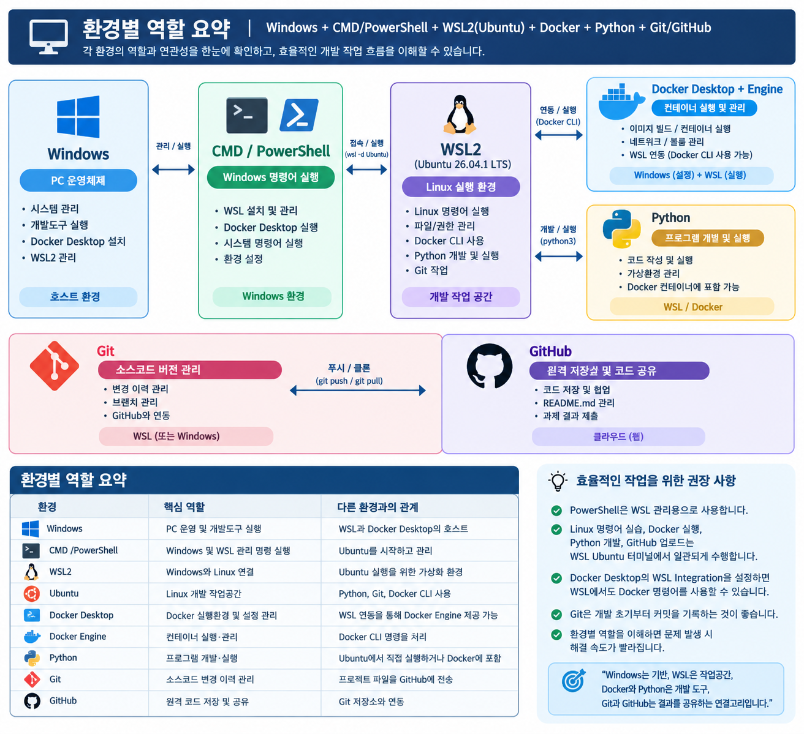

*그림: 환경별 개발 워크플로 — GitHub 저장소에 업로드된 실제 증빙 이미지*


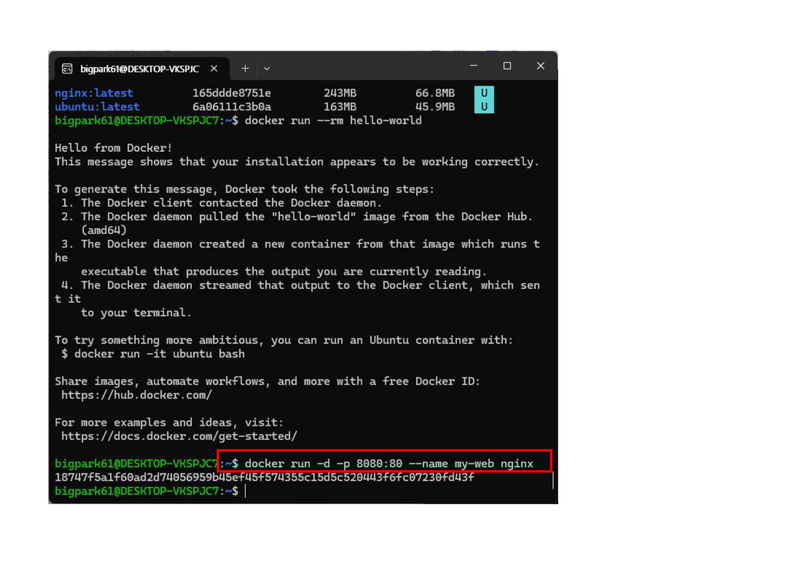

*그림: 기존 hello-world 및 NGINX 실습 — GitHub 저장소에 업로드된 실제 증빙 이미지*


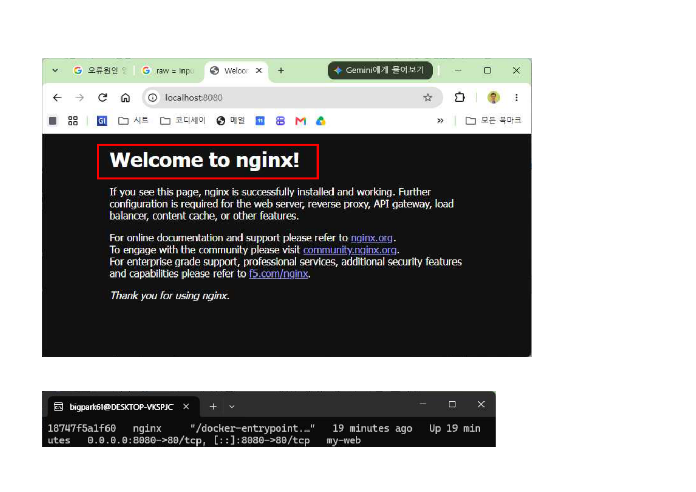

*그림: 기존 8080 포트 접속 — GitHub 저장소에 업로드된 실제 증빙 이미지*


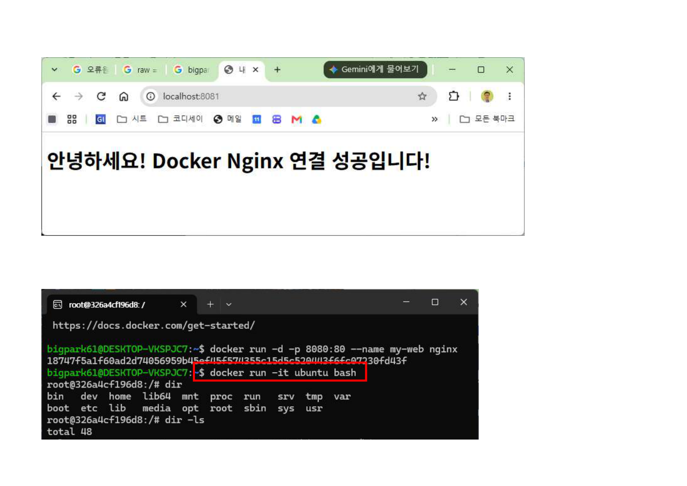

*그림: 기존 8081 포트 접속 — GitHub 저장소에 업로드된 실제 증빙 이미지*


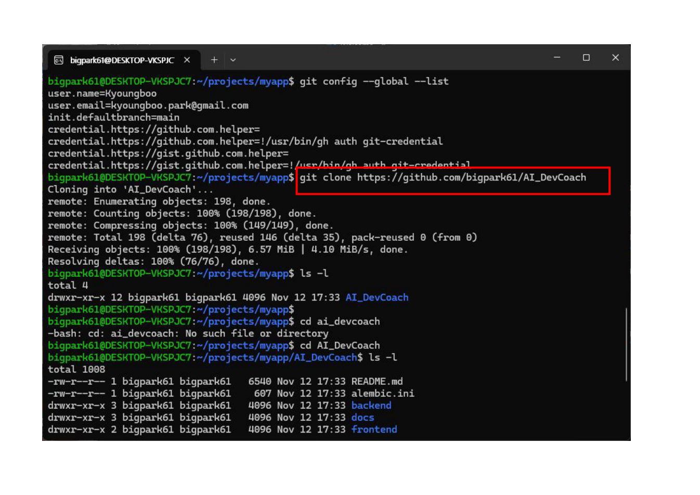

*그림: 기존 Git 설정 및 Clone — GitHub 저장소에 업로드된 실제 증빙 이미지*


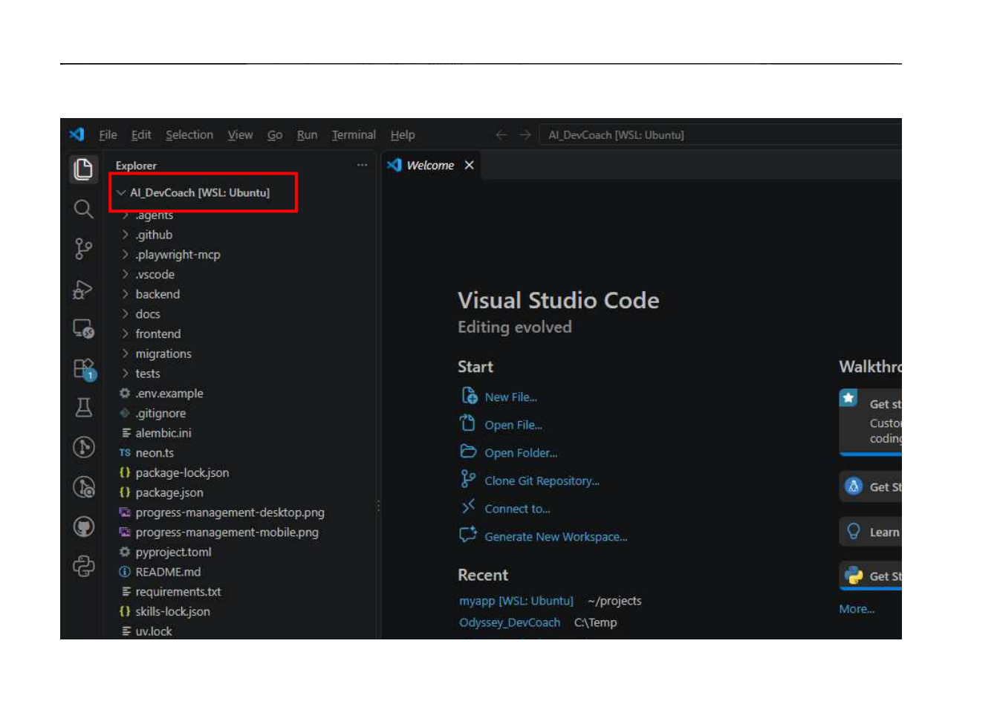

*그림: VSCode의 WSL 프로젝트 연동 — GitHub 저장소에 업로드된 실제 증빙 이미지*


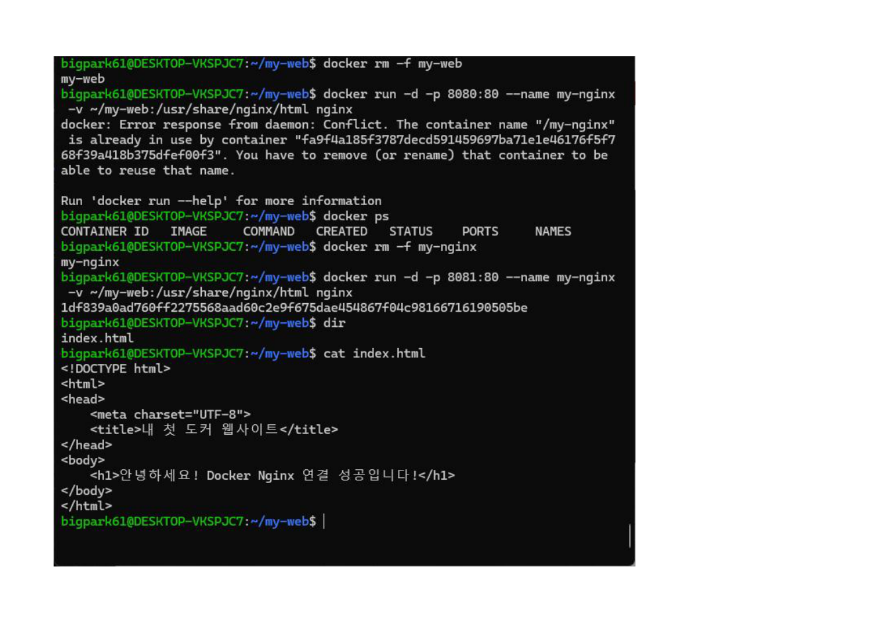

*그림: 기존 컨테이너 이름 충돌 사례 — GitHub 저장소에 업로드된 실제 증빙 이미지*


## 부록 B. 보관 및 재현을 위한 명령어 모음

```bash
# Ubuntu / WSL에서 기본 점검
pwd
ls -la
docker --version
docker info --format '{{.ServerVersion}}'

# Docker 이미지 / 컨테이너 관리
docker images
docker ps -a
docker logs --tail 20 codyssey-web
docker stats --no-stream

# 웹 서비스 검증
curl -s http://localhost:8083 | grep '<h2>'
curl -s http://localhost:8084 | grep '<h2>'

# 데이터 볼륨 존재 확인
docker volume ls
docker volume inspect codyssey-data

# Git 제출 확인 (Windows 또는 WSL에서 해당 저장소 경로로 이동 후)
git remote -v
git status
git log -1 --oneline
```

### 보안 및 재현성 유의사항

- 운영체제·Docker 버전 및 실제 사용자 홈 경로는 PC마다 다르다.
- Docker Desktop이 설치되어 있어도 엔진이 실행 중이어야 `docker info` 및 컨테이너 실행이 가능하다.
- 인증 토큰·비밀번호·개인키와 일회용 인증 코드는 GitHub에 커밋하지 않는다.
- 본문의 이미지 링크는 `images/` 상대경로를 사용한다. `images/` 폴더를 이동하거나 파일명을 변경하면 링크도 함께 수정해야 한다.
- 이 보고서는 과제 수행 **기록 문서**이며, 저장소의 기존 `README.md`를 자동 교체하지 않는다. 이미지를 보려면 `images/` 폴더를 보고서 파일과 같은 상위 폴더에 보존한다.
