# AIO E1-1 | 내 컴퓨터에 개발자용 작업실 꾸미기

> **미션:** Linux CLI · 파일 권한 · Docker · Dockerfile · 포트 매핑 · Bind Mount · Docker Volume · Git/GitHub를 이용한 재현 가능한 개발 워크스테이션 구축  
> **수행 기간:** 2026년 11월 (제공 로그 기준)  
> **제출 저장소:** https://github.com/bigpark61/develop_environment  
> **문서 상태:** 2026-11-23 신규 실습 및 캡처 반영. GitHub 최종 Push와 일부 추가 증빙은 확인 전.

## 1. 개발 환경 구성

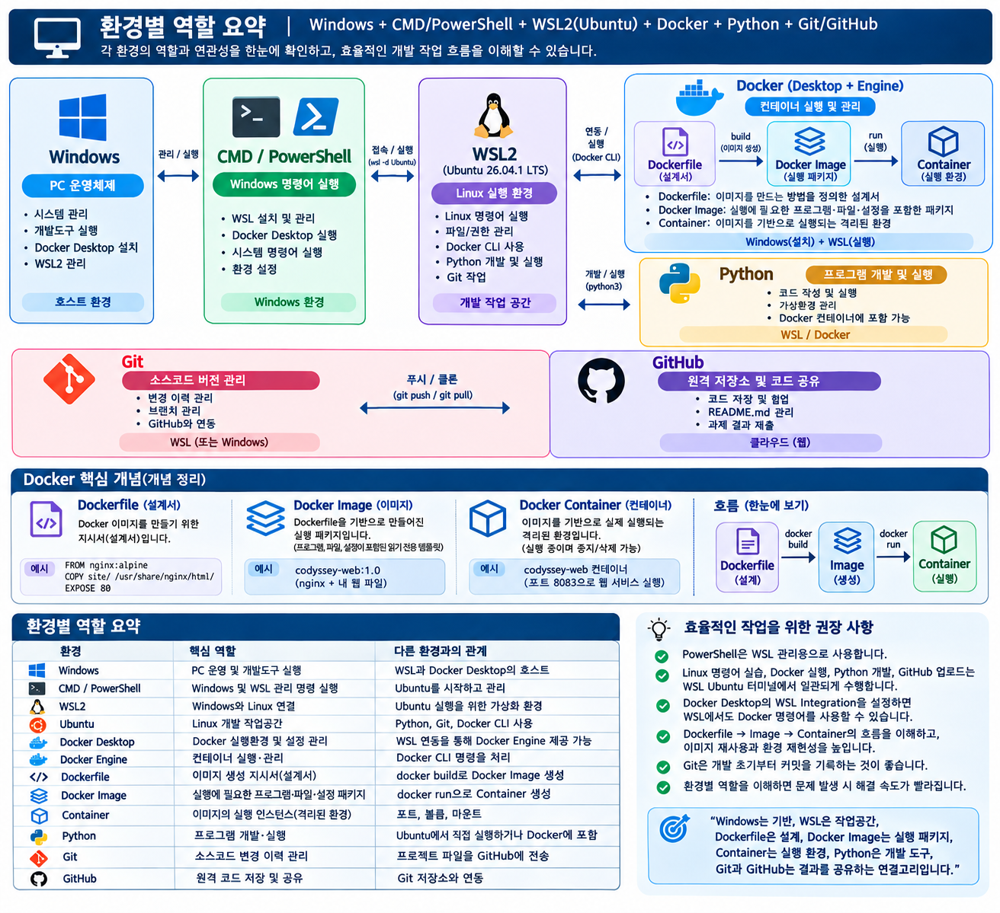

> 위 구성도는 Windows → WSL2 Ubuntu → Docker 개발 환경의 연결 관계와 `Dockerfile → docker build → Docker Image → docker run → Container` 흐름을 설명한다. 아래의 기존 구성도는 환경별 역할을 보완하는 참고 자료다.

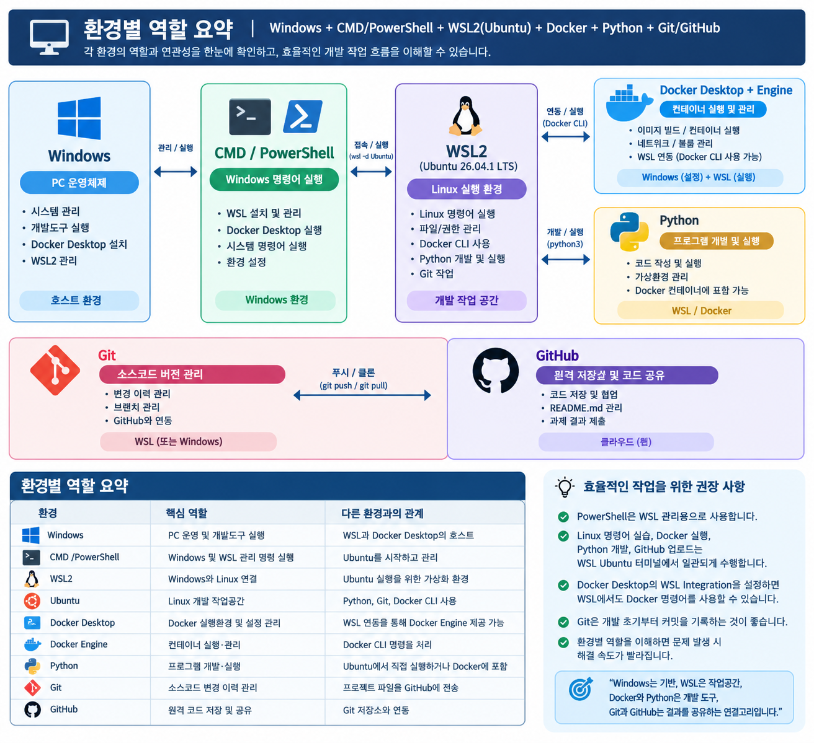

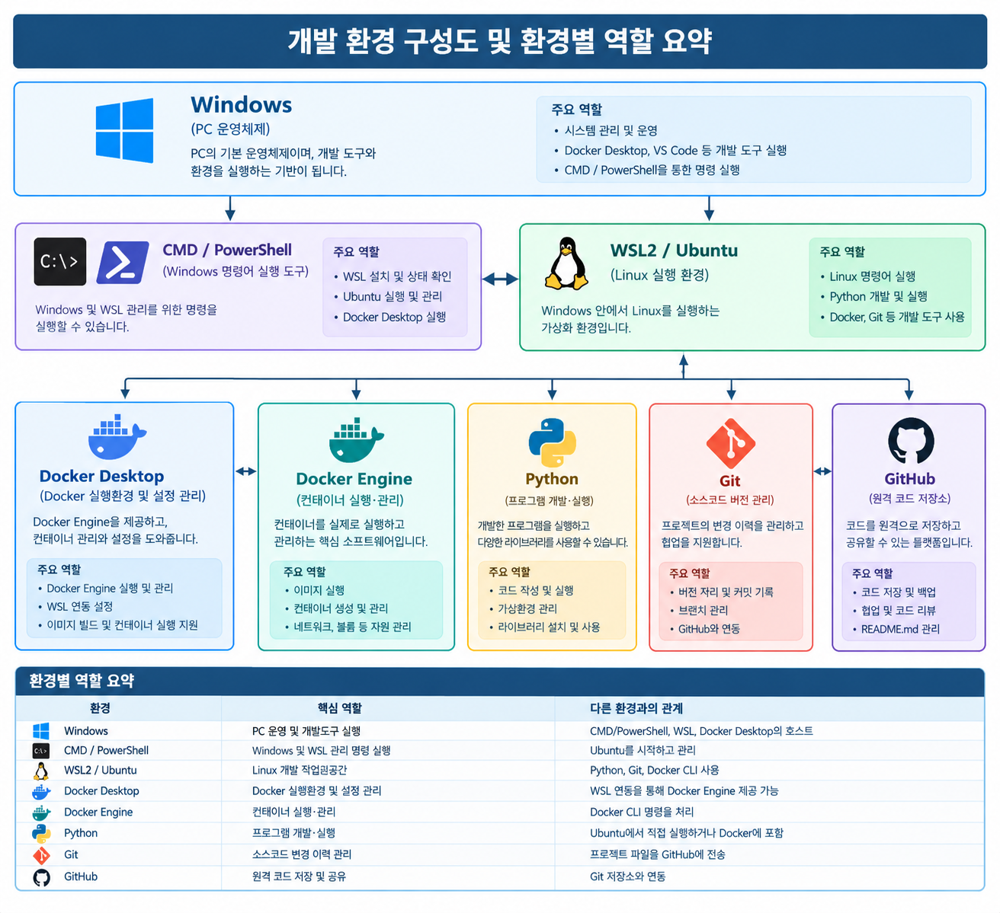

| 구성 요소 | 확인된 환경 | 역할 |
|---|---|---|
| 호스트 OS | Windows 11 Home 25H2, 빌드 26200.9711 | PC 및 Docker Desktop 운영 |
| Linux | WSL2 기반 Ubuntu 26.04.1 LTS, Bash | CLI·Git·Docker 명령 실행 |
| Docker | CLI/Server 29.9.2, Docker Desktop 4.98.0 | 이미지 및 컨테이너 관리 |
| Git | 기존 기록: Ubuntu 2.53.0 (Windows 2.52.0.windows.1); 신규 PC Git 버전 별도 확인 필요 | 로컬 버전 관리 |
| VSCode | 1.139.1 | WSL 개발 작업 |
| Python (추가 실습) | 3.14.4 / pip 25.1.1 | 가상환경 실습 (미션 필수 아님) |

> 참고: 기존 PC 로그에는 Docker 29.9.2 기록이 있으며, 이번 신규 PC 실습에서는 Docker 29.9.3으로 확인했다. `wsl --list --verbose`에서 Ubuntu `Running`, `VERSION 2`를 확인했다. 다른 PC의 환경 기록이 혼동되지 않도록 구분한다.

```bash
# Ubuntu에서 실제 실행·확인한 명령
$ git --version
 git version 2.53.0
$ docker --version
 Docker version 29.9.2, build a82e528
$ docker info
 Server:
  Server Version: 29.9.2
  Operating System: Docker Desktop
$ code --version
 1.139.1
```

**WSL 통합 설정 캡처**  
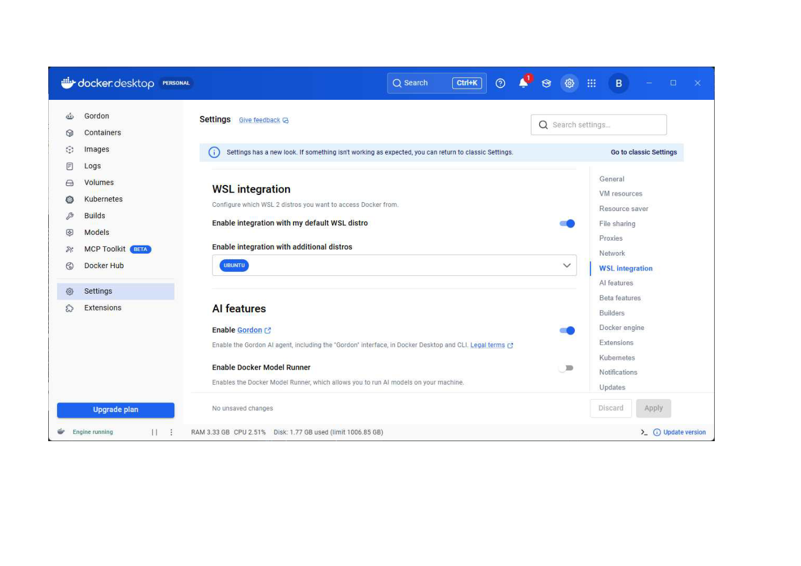

## 2. 필수 수행 체크리스트

- [x] Linux CLI: 경로 확인, 생성, 목록, 복사, 이름변경, 삭제, 파일 내용 확인
- [x] 파일·디렉터리 권한 변경 전후 비교 (`chmod 600 test.txt`, `chmod 700 sample_dir`)
- [x] Docker CLI/엔진 버전 및 연결 확인 (`29.9.3`, ServerVersion 출력)
- [x] Docker 운영 명령 실행 (`docker images`, `docker ps -a`, `docker logs`, `docker stats --no-stream`)
- [x] `hello-world` 실행 및 Ubuntu 컨테이너 내부 `pwd`, `ls`, `echo` 실행
- [x] 직접 작성한 `Dockerfile`로 `codyssey-web:1.0` 이미지 빌드 및 실행
- [x] 포트 매핑 및 Windows 브라우저 `localhost:8083` 접속
- [x] Bind Mount: 호스트 HTML 수정 즉시 `localhost:8084`에 반영
- [x] Docker Volume: `volume-test` 삭제 후 새 컨테이너에서 기존 파일 읽기
- [x] GitHub 저장소 복제 및 원격 `origin` 연결 확인, 기존 Git/VSCode 연동 증빙
- [ ] 신규 파일 및 README를 `develop_environment`에 commit/push 후 GitHub 원격 확인
- [x] 트러블슈팅 실제 사례 2건 이상 기록

> 체크표시 `[x]`는 실제 로그 또는 스크린샷으로 확인된 수행 항목이며, GitHub 원격 업로드는 로컬에서 아직 수행하지 않았다.

## 3. Linux CLI 실습 기록

`Logs_01.md`에서 확인한 작업 위치: `/home/bigpark61/codyssey/practice`

```bash
$ pwd
/home/bigpark61
$ mkdir -p ~/codyssey
$ cd ~/codyssey
$ mkdir practice
$ cd practice
$ touch test.txt
$ echo "Hello Codyssey" > test.txt
$ cat test.txt
Hello Codyssey
$ cp test.txt copy.txt
$ mv copy.txt result.txt
$ ls -la
# test.txt, result.txt 목록 확인
$ rm result.txt
```

- **절대 경로:** `/home/bigpark61/codyssey/practice`처럼 루트(`/`)부터 위치를 표현한다.
- **상대 경로:** 현재 위치에서 `practice`, `../`처럼 표현한다.
- **숨김 파일:** `ls -la`로 확인한다.
- **권한:** `r` 읽기(4), `w` 쓰기(2), `x` 실행/디렉터리 진입(1). `755`는 소유자 `rwx`, 그룹·기타 `r-x`; `644`는 소유자 `rw-`, 그룹·기타 `r--`이다.

실제 로그에서 `test.txt`의 초기 권한 `-rw-r--r--`와 후속 권한 `-rwxr-xr-x`가 확인된다. 이번 신규 실습에서 `chmod 600 test.txt`, `chmod 700 sample_dir`로 파일과 디렉터리 변경 전후를 검증했다. 자세한 내용은 6.5절을 참조한다.

[CLI 및 환경 점검 원본 로그](evidence/Logs_01.md)

## 4. Docker 설치 및 컨테이너 검증

### 4.1 Docker Engine 동작

Ubuntu의 `docker info`에서 Docker Desktop 서버 연결 성공을 확인했다. 최초 Windows CMD 출력의 Docker API 연결 실패는 이후 정상 연결 기록과 구분한다.

### 4.2 hello-world 성공

```bash
$ docker run hello-world
Hello from Docker!
This message shows that your installation appears to be working correctly.
```

### 4.3 Ubuntu 컨테이너 내부 진입

```bash
$ docker run -it ubuntu bash
root@...:/# dir
root@...:/# dir -ls
```

실행 캡처 14~15페이지에서 Ubuntu 컨테이너 진입 및 내부 목록 출력을 확인했다. `docker run`은 이미지로 새 컨테이너를 생성하며, `docker exec`는 실행 중인 기존 컨테이너에 명령을 수행한다. 메인 프로세스가 종료되면 컨테이너도 종료될 수 있다.

### 4.4 이미지·컨테이너 확인

```bash
$ docker images
# hello-world:latest, ubuntu:latest 확인
$ docker ps -a
# 종료된 hello-world 및 ubuntu-test 컨테이너 목록 확인
```

신규 실습에서 `docker logs --tail 20 codyssey-web` 및 `docker stats --no-stream` 출력까지 확인했다. 자세한 내용은 6.6절을 참조한다.

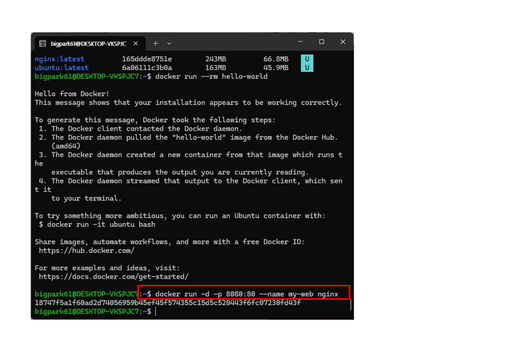

## 5. NGINX 웹 서버와 포트 매핑

실행 캡처에서 기본 NGINX 이미지를 이용한 웹 서버 실행을 확인했다.

```bash
$ docker run -d -p 8080:80 --name my-web nginx
# 컨테이너 ID 출력
```

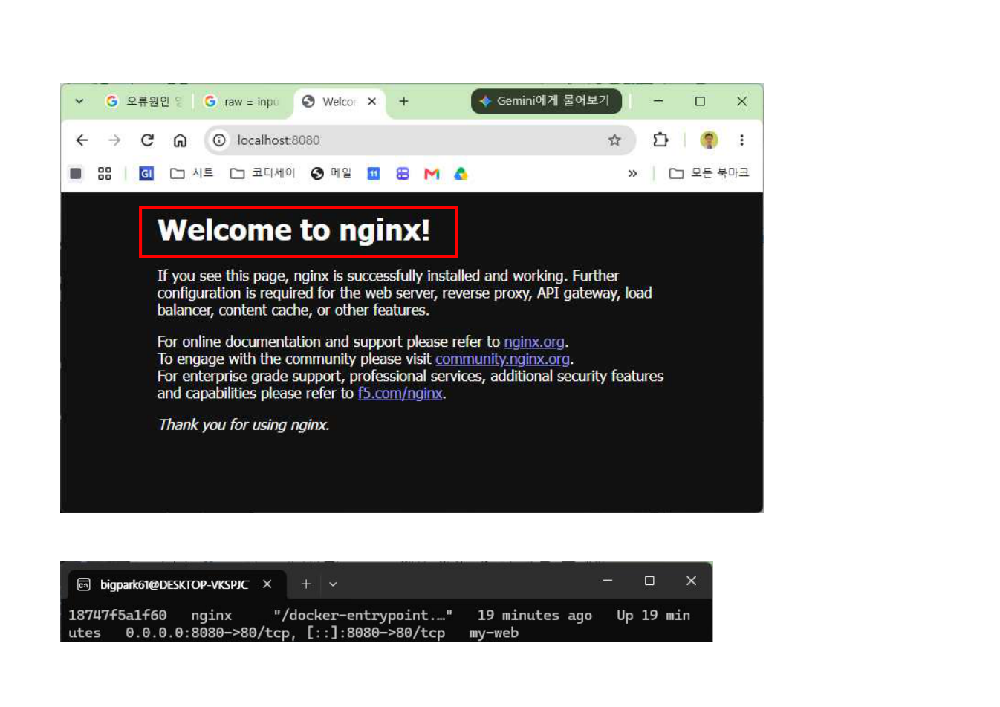

또한 `8081:80` 매핑으로 HTML 페이지의 `안녕하세요! Docker Nginx 연결 성공입니다!` 문구가 브라우저에 표시된 것을 확인했다.

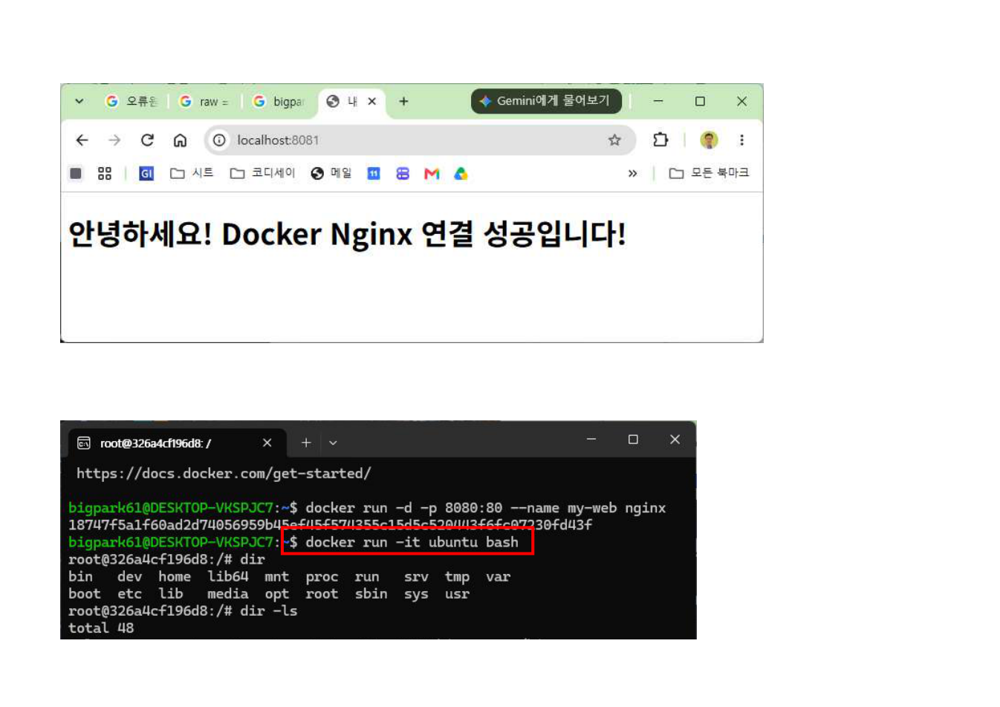

**원리:** `-p 8080:80`은 호스트의 8080 포트를 컨테이너 내부 NGINX의 80 포트에 연결한다.

**기존 기록과 신규 실습 구분:** 이 절의 8080/8081 캡처는 기본 NGINX 이미지의 접속 증빙이다. 별도로 신규 실습에서 Dockerfile 커스텀 이미지와 Bind Mount를 성공적으로 검증했으며 해당 증거는 6.2~6.3절에 있다.

## 6. Dockerfile · 이미지 · 컨테이너 / Bind Mount / Volume 실제 검증

### 6.1 기본 개념

| 구분 | 의미 | 실제 파일 또는 실행 결과 |
|---|---|---|
| Dockerfile | 이미지를 만드는 제작 지시서 | [`Dockerfile`](Dockerfile) |
| Docker Image | 프로그램 및 실행 파일을 포함한 패키지 | `codyssey-web:1.0` |
| Docker Container | 이미지 기반으로 실행되는 인스턴스 | `codyssey-web` (`8083:80`) |
| Bind Mount | 호스트의 디렉터리를 컨테이너에서 직접 참조 | `codyssey-bind` (`8084:80`) |
| Docker Volume | Docker가 관리하는 컨테이너 외부 데이터 저장 공간 | `codyssey-data` |

**Dockerfile → `docker build` → 이미지 → `docker run` → 컨테이너** 순서로 생성한다.

### 6.2 Dockerfile 작성 및 커스텀 이미지 빌드 — 성공

프로젝트 파일: [`Dockerfile`](Dockerfile), [`site/index.html`](site/index.html)

```dockerfile
FROM nginx:alpine
LABEL org.opencontainers.image.title="codyssey-web"
COPY site/ /usr/share/nginx/html/
EXPOSE 80
```

- 베이스 이미지: `nginx:alpine` — 경량 NGINX 웹 서버 사용
- 커스텀 포인트: `COPY site/ /usr/share/nginx/html/` — 직접 작성한 HTML을 이미지에 포함
- `EXPOSE 80` — 컨테이너 내부에서 사용하는 포트를 명시(외부 공개는 `-p`로 별도 지정)

```bash
cd ~/codyssey/dockerfile-web
docker build -t codyssey-web:1.0 .
# [+] Building 5.1s (8/8) FINISHED
# naming to docker.io/library/codyssey-web:1.0

docker run -d --name codyssey-web -p 8083:80 codyssey-web:1.0
curl http://localhost:8083
```

Windows 브라우저에서 `http://localhost:8083` 접속 시 `Codyssey Docker Mission E1-1`, `Custom Docker Image Test` 출력 확인.

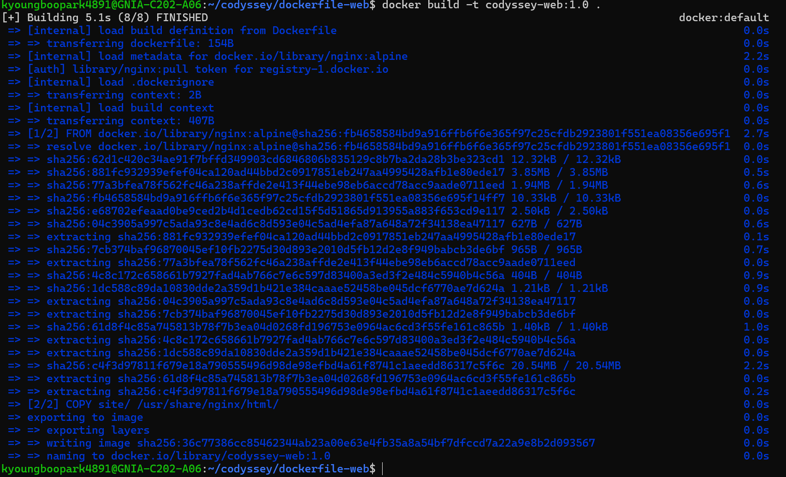
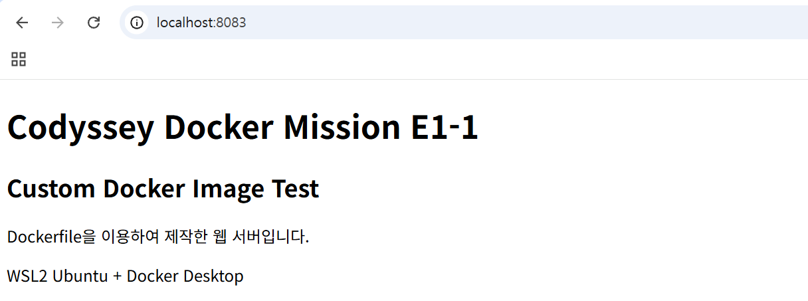

### 6.3 Bind Mount — 호스트 파일 변경 반영 성공

```bash
cd ~/codyssey/dockerfile-web
docker run -d --name codyssey-bind -p 8084:80 \
  -v "$(pwd)/site:/usr/share/nginx/html:ro" nginx:alpine

# site/index.html <h2> 내용을 아래와 같이 변경
# 기존: Custom Docker Image Test
# 변경: Bind Mount Update Success!

curl -s http://localhost:8084 | grep '<h2>'
# <h2>Bind Mount Update Success!</h2>
curl -s http://localhost:8083 | grep '<h2>'
# <h2>Custom Docker Image Test</h2>
```

- `8084`는 바인드 마운트에 연결된 현재 호스트 파일을 읽어 **수정된 문구**를 표시했다.
- `8083`은 이미지 빌드 당시 HTML을 유지해 **원래 문구**를 표시했다.
- 이미지 재빌드와 컨테이너 재시작 없이 변경 사항이 반영되는 것을 확인했다.

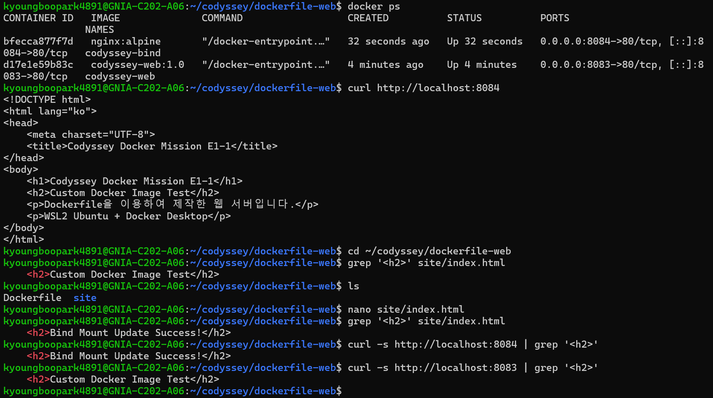

### 6.4 Docker Volume — 컨테이너 삭제 후 데이터 유지 성공

```bash
docker volume create codyssey-data
# codyssey-data
docker volume inspect codyssey-data
# Driver: local, Name: codyssey-data

docker run -it --name volume-test -v codyssey-data:/data ubuntu bash
# 컨테이너 내부
echo "Docker Volume Persistence Test" > /data/test.txt
cat /data/test.txt
# Docker Volume Persistence Test
exit

# WSL Ubuntu에서 기존 컨테이너 삭제
docker rm volume-test
# volume-test

# 동일 볼륨을 새 컨테이너에 연결해서 읽기
docker run --rm --name volume-test2 -v codyssey-data:/data \
  ubuntu cat /data/test.txt
# Docker Volume Persistence Test

docker volume ls
# local codyssey-data
```

**결론:** 기존 `volume-test` 컨테이너를 삭제한 뒤 새 `volume-test2` 컨테이너에서 동일한 문자열을 읽었고, `codyssey-data` 볼륨도 유지되었다. 볼륨 자체를 삭제하면 데이터도 사라질 수 있다.

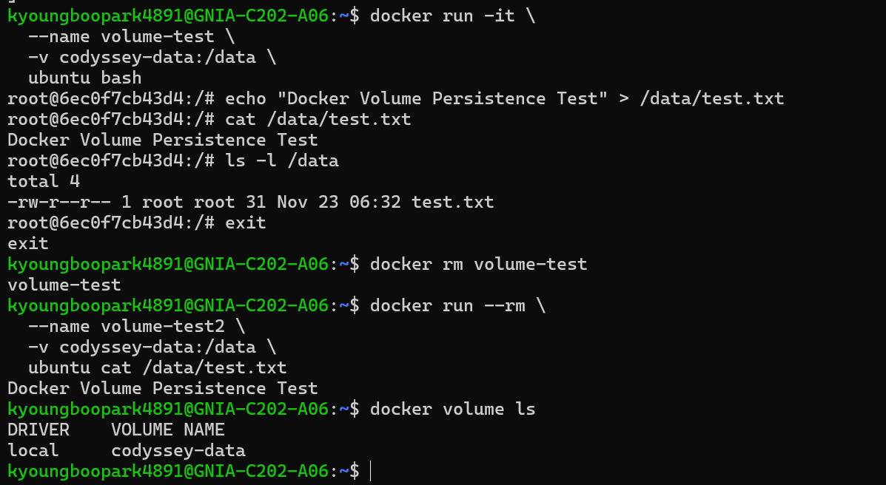

### 6.5 Linux 파일·디렉터리 권한 변경 — 성공

위치: `~/codyssey/permission-practice` (로컬 실습 경로)

```bash
mkdir -p ~/codyssey/permission-practice/sample_dir
cd ~/codyssey/permission-practice
echo "Linux Permission Test" > test.txt
ls -l test.txt
# -rw-r--r-- ... test.txt
ls -ld sample_dir
# drwxr-xr-x ... sample_dir
chmod 600 test.txt
chmod 700 sample_dir
ls -l test.txt
# -rw------- ... test.txt
ls -ld sample_dir
# drwx------ ... sample_dir
```

| 대상 | 변경 전 | 변경 후 | 의미 |
|---|---|---|---|
| `test.txt` | `644` (`rw-r--r--`) | `600` (`rw-------`) | 소유자만 읽기·쓰기 |
| `sample_dir` | `755` (`rwxr-xr-x`) | `700` (`rwx------`) | 소유자만 접근·진입 |

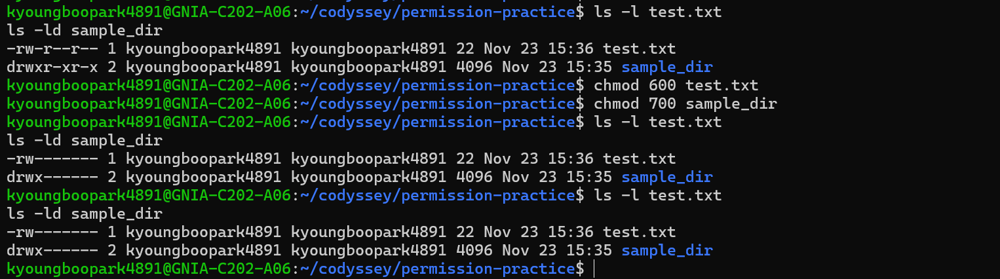

### 6.6 Docker 이미지·컨테이너·로그·자원 사용량 — 성공

```bash
docker images
# codyssey-web:1.0, hello-world:latest, nginx:alpine, ubuntu:latest

docker ps -a
# codyssey-web: Up, 8083->80/tcp
# codyssey-bind: Up, 8084->80/tcp
# ubuntu-lab: Exited (137)
# hello-world: Exited (0)

docker logs --tail 20 codyssey-web
# GET / HTTP/1.1 200
# GET /favicon.ico HTTP/1.1 404 (아이콘 파일 미존재)

docker stats --no-stream
# codyssey-bind: CPU 0.00%, MEM 18.42MiB
# codyssey-web:  CPU 0.00%, MEM 18.48MiB
```

`favicon.ico`의 404는 브라우저의 아이콘 요청에 대한 응답이며 홈페이지 자체는 HTTP 200으로 정상 제공되었다. `Exited (137)`은 강제 종료 신호(SIGKILL)로 종료되었음을 뜻하며 원인은 화면만으로 확정하지 않는다.

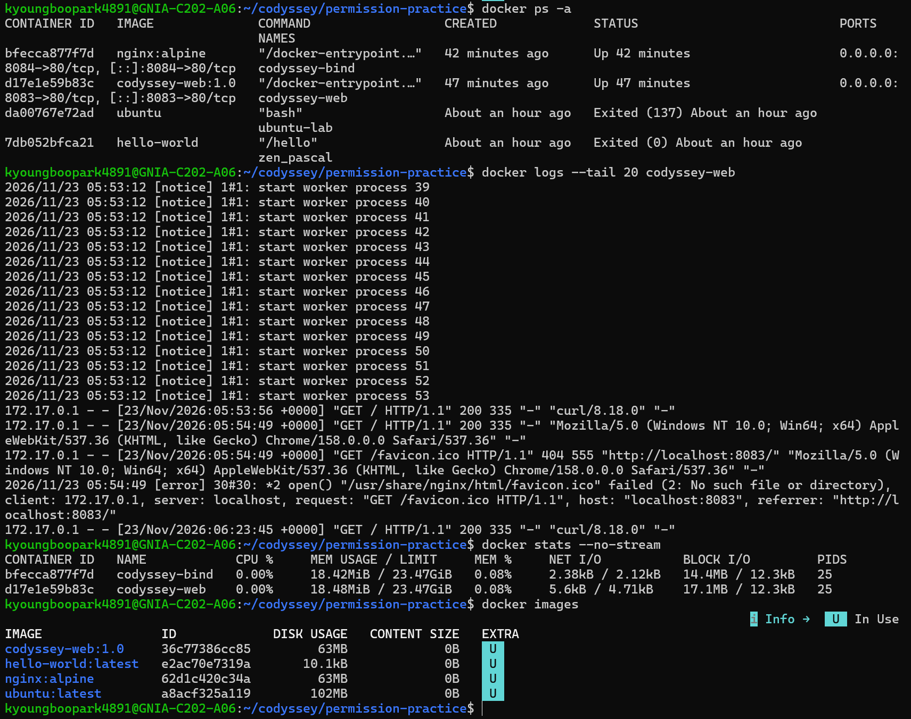

## 7. Git · GitHub · VSCode 연동

Ubuntu에서 확인된 설정:

```bash
$ git config --global --list
user.name=Kyoungboo
# user.email 설정 확인됨 (공개 README에는 이메일 생략)
init.defaultbranch=main
```

- `gh auth login`으로 GitHub CLI 인증 성공 및 `bigpark61` 계정 로그인 확인
- `git clone https://github.com/bigpark61/AI_DevCoach` 성공
- `code .` 명령으로 WSL 환경의 VSCode에서 복제 저장소 열기 성공
- GitLens, GitHub Pull Requests, Python 확장 설치 기록 확인

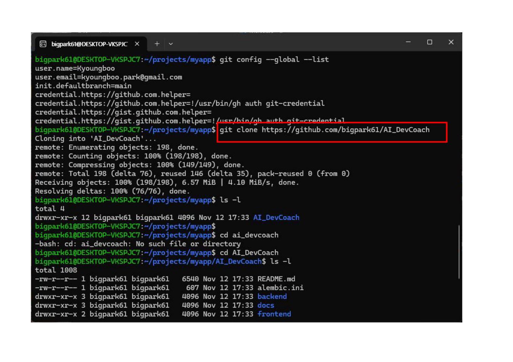

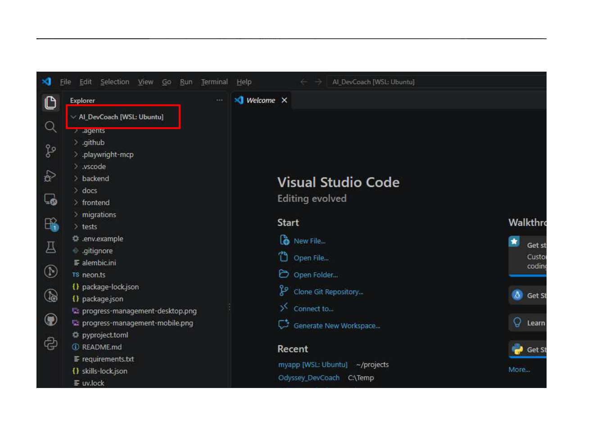

> 주의: `AI_DevCoach` 복제 성공은 GitHub 연동 증거이지만, **이번 과제 제출 저장소 `develop_environment`로 Push 성공했다는 증거는 아니다.** 제출 저장소의 `git remote -v`, `git status`, `git log -1` 및 GitHub 파일 목록을 추가로 확인해야 한다.

## 8. 추가 실습 (미션 필수 외)

`Logs_02.md`에서 Python 가상환경 생성 및 도구 설치를 확인했다.

```bash
$ python3 -m venv .venv
$ source .venv/bin/activate
$ pip install ruff
$ ruff check .
warning: No Python files found under the given path(s)
All checks passed!
```

이는 검사 대상 Python 파일이 없었다는 의미이며 **실제 Python 코드의 품질 검증 완료를 뜻하지 않는다.** `direnv` 설치 및 `.envrc` 생성·허용도 확인된다.

[추가 개발 도구 실습 로그](evidence/Logs_02.md)

## 9. 트러블슈팅

### 사례 1. Docker Desktop 엔진 연결 실패 → 이후 연결 성공

- **문제:** Windows CMD `docker info`에서 `dockerDesktopLinuxEngine` 파이프를 찾지 못해 API 연결 실패.
- **원인 가설:** 당시 Docker Desktop 엔진 미실행 또는 초기화 미완료.
- **확인:** Ubuntu에서 `docker info` 재실행.
- **결과:** `Server Version: 29.9.2`, `Operating System: Docker Desktop` 확인.
- **해결/대안:** 이후 정상 상태는 입증되지만, 정확히 어떤 조치로 복구되었는지는 로그에서 확인되지 않는다.

### 사례 2. 컨테이너 이름 중복 → 기존 컨테이너 제거 후 재실행

- **문제:** `--name my-nginx`로 재실행 시 `Conflict. The container name ... is already in use` 오류.
- **원인:** 동일 이름의 컨테이너가 이미 존재.
- **확인:** `docker ps`와 오류 메시지 확인.
- **조치:** `docker rm -f my-nginx` 후 다른 포트(`8081:80`)로 실행.
- **재검증:** `localhost:8081`에서 사용자 정의 HTML 문구 표시.


### 사례 3. Linux 명령어 오타

- **문제:** `cat "Hello Codyssey" > text.txt`에서 `No such file or directory`.
- **원인:** `cat`은 파일 내용을 읽으므로 문자열을 파일에 쓰려면 `echo` 사용 필요.
- **조치:** `echo "Hello Codyssey" > test.txt`.
- **재검증:** `cat test.txt`에서 `Hello Codyssey` 확인.

### 사례 4. GitHub CLI 브라우저 자동 실행 실패

- **문제:** WSL에서 `gh auth login` 실행 중 브라우저 실행 프로그램을 찾지 못함.
- **대안:** Windows 브라우저에서 인증 페이지를 직접 열어 인증.
- **재검증:** `Authentication complete`, `Logged in as bigpark61` 확인.
- **보안:** 일회용 인증 코드는 공개 문서에 수록하지 않음.

## 10. 증빙 자료 인덱스

| 수행 항목 | 증빙 파일 |
|---|---|
| 개발 환경 및 개념 | [환경 구성도](evidence/environment-workflow-docker-concepts.png) · [기존 워크플로](evidence/environment-workflow.png) |
| WSL / Docker 연동 | [WSL Integration](evidence/docker-wsl-integration.png) |
| 터미널 및 설치 로그 | [Logs_01.md](evidence/Logs_01.md) · [Logs_02.md](evidence/Logs_02.md) |
| hello-world / NGINX 기존 실행 | [Docker 시작](evidence/docker-hello-nginx.png) · [8080](evidence/nginx-8080.png) · [8081](evidence/nginx-8081-ubuntu.png) |
| Dockerfile 빌드 | [dockerfile-build.png](evidence/dockerfile-build.png) |
| 커스텀 웹 페이지 접속 | [dockerfile-web-8083.png](evidence/dockerfile-web-8083.png) |
| Bind Mount 변경 비교 | [bind-mount-verification.png](evidence/bind-mount-verification.png) |
| Docker Volume 영속성 | [docker-volume-persistence.png](evidence/docker-volume-persistence.png) |
| Linux 권한 변경 | [linux-permission-change.png](evidence/linux-permission-change.png) |
| Docker 운영 명령 | [docker-operations-final.png](evidence/docker-operations-final.png) |
| Git / VSCode | [Git 설정·복제](evidence/git-config-clone.png) · [VSCode WSL](evidence/vscode-wsl-repository.png) |
| 트러블슈팅 | [컨테이너 중복 이름](evidence/docker-name-conflict.png) · README 9절 |

## 11. 최종 요구사항 검증 및 제출 상태

| 과제 요구사항 | 구현·증빙 위치 | 상태 |
|---|---|---|
| OS/WSL/셸/Docker 정보 | 1절, 기존 로그 및 신규 실행 기록 | 확인 |
| Linux CLI 파일 조작 | 3절, Logs_01 | 확인 |
| 파일·디렉터리 권한 변경 | 6.5절, 권한 캡처 | 확인 |
| Docker 설치·엔진 | 1·4절, 신규 `ServerVersion 29.9.3` | 확인 |
| Docker `images`, `ps`, `logs`, `stats` | 6.6절, 운영 캡처 | 확인 |
| hello-world 및 Ubuntu 내부 실습 | 4절, 신규 실행 캡처 | 확인 |
| Dockerfile 커스텀 이미지 빌드/실행 | 6.2절, Dockerfile, HTML, 빌드·웹 캡처 | 확인 |
| 포트 매핑 접속 | 5·6.2절, 8083 캡처 | 확인 |
| Bind Mount 변경 반영 | 6.3절, 비교 캡처 | 확인 |
| Docker Volume 영속성 | 6.4절, 데이터 유지 캡처 | 확인 |
| Git 설정·GitHub/VSCode 연동 | 7절, 기존 캡처 및 신규 clone | 확인 |
| 트러블슈팅 2건 이상 | 9절 | 확인 |
| 신규 README·소스·증빙 GitHub commit/push | 아직 `git status`에서 Untracked, 원격 미반영 | **미완료** |

### 제출 직전 실행 및 확인

```bash
cd ~/codyssey/develop_environment
# 원격 연결 확인
git remote -v
# 백업 파일은 로컬에 보관하고 Git에 추가하지 않음
git status --short
# 필요한 파일만 스테이징
git add README.md Dockerfile site/index.html evidence/*.png
# 실제 GitHub 반영은 이어지는 단계에서 진행
git commit -m "docs: complete E1-1 Docker and Linux verification evidence"
git push origin main
```

**보안 주의:** README와 이미지에 토큰, 비밀번호, 인증 코드 및 개인키를 포함하지 않는다. 호스트 경로는 예시와 다를 수 있다. `README.backup.md`는 GitHub에 업로드하지 않고 로컬 백업으로만 유지한다.
