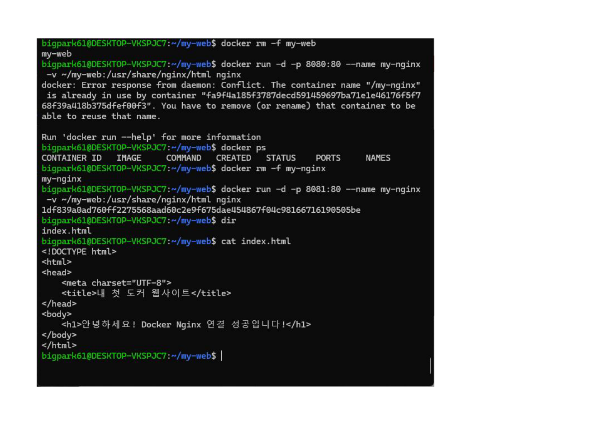

# AIO E1-1 | 내 컴퓨터에 개발자용 작업실 꾸미기

> **미션:** Linux CLI · 파일 권한 · Docker · Dockerfile · 포트 매핑 · Bind Mount · Docker Volume · Git/GitHub를 이용한 재현 가능한 개발 워크스테이션 구축  
> **수행 기간:** 2026년 11월 (제공 로그 기준)  
> **제출 저장소:** https://github.com/bigpark61/develop_environment  
> **문서 상태:** 제공된 로그·캡처를 반영한 중간 검증본. 미확인 항목은 완료로 표시하지 않음.

## 1. 개발 환경 구성


| 구성 요소 | 확인된 환경 | 역할 |
|---|---|---|
| 호스트 OS | Windows 11 Home 25H2, 빌드 26200.9711 | PC 및 Docker Desktop 운영 |
| Linux | WSL2 기반 Ubuntu 26.04.1 LTS, Bash | CLI·Git·Docker 명령 실행 |
| Docker | CLI/Server 29.9.2, Docker Desktop 4.98.0 | 이미지 및 컨테이너 관리 |
| Git | Ubuntu 2.53.0 (Windows 2.52.0.windows.1) | 로컬 버전 관리 |
| VSCode | 1.139.1 | WSL 개발 작업 |
| Python (추가 실습) | 3.14.4 / pip 25.1.1 | 가상환경 실습 (미션 필수 아님) |

> 참고: Windows CMD에서 실행한 초기 `docker info`는 엔진 연결에 실패했으나, 이후 Ubuntu에서 실행한 `docker info`는 `Server Version: 29.9.2`를 반환했다. 시점별 상태가 다르므로 초기 오류를 현재의 장애로 단정하지 않는다. `wsl --list --verbose` 출력은 별도 확인이 필요하다.

```bash
# Ubuntu에서 실제 실행·확인한 명령
$ git --version
 git version 2.53.0
$ docker --version
 Docker version 29.9.2, build a82e528
$ docker info
 Server:
  Server Version: 29.9.2
  Operating System: Docker Desktop
$ code --version
 1.139.1
```

**WSL 통합 설정 캡처**  


## 2. 필수 수행 체크리스트

- [x] Linux CLI: 경로 확인, 생성, 목록, 복사, 이름변경, 삭제, 파일 내용 확인
- [ ] 파일·디렉터리 **각각** 권한 변경 전후 비교 (파일 권한 결과만 일부 확인)
- [x] Docker CLI/엔진 버전 및 연결 확인
- [ ] Docker 운영 명령 전부 (`docker stats` 성공 출력 추가 필요)
- [x] `hello-world` 실행 및 Ubuntu 컨테이너 진입
- [ ] **직접 작성한 Dockerfile**로 커스텀 이미지 빌드·실행
- [x] NGINX 기본 이미지 포트 매핑 및 브라우저 접속
- [ ] Bind Mount: 호스트 파일 수정 전후 컨테이너 반영 비교
- [ ] Docker Volume: 컨테이너 삭제 전후 데이터 유지 검증
- [x] Git 사용자·기본 브랜치 설정, GitHub CLI 인증, VSCode WSL에서 저장소 열기
- [ ] 과제 제출 저장소 `develop_environment`에 최신 결과 Push 확인
- [x] 실제 트러블슈팅 사례 2건 이상 기록 (해결·재검증 여부 구분)

## 3. Linux CLI 실습 기록

`Logs_01.md`에서 확인한 작업 위치: `/home/bigpark61/codyssey/practice`

```bash
$ pwd
/home/bigpark61
$ mkdir -p ~/codyssey
$ cd ~/codyssey
$ mkdir practice
$ cd practice
$ touch test.txt
$ echo "Hello Codyssey" > test.txt
$ cat test.txt
Hello Codyssey
$ cp test.txt copy.txt
$ mv copy.txt result.txt
$ ls -la
# test.txt, result.txt 목록 확인
$ rm result.txt
```

- **절대 경로:** `/home/bigpark61/codyssey/practice`처럼 루트(`/`)부터 위치를 표현한다.
- **상대 경로:** 현재 위치에서 `practice`, `../`처럼 표현한다.
- **숨김 파일:** `ls -la`로 확인한다.
- **권한:** `r` 읽기(4), `w` 쓰기(2), `x` 실행/디렉터리 진입(1). `755`는 소유자 `rwx`, 그룹·기타 `r-x`; `644`는 소유자 `rw-`, 그룹·기타 `r--`이다.

실제 로그에서 `test.txt`의 초기 권한 `-rw-r--r--`와 후속 권한 `-rwxr-xr-x`가 확인된다. **변경에 사용한 `chmod` 명령 및 디렉터리 권한 변경 전후는 제출 자료에서 확인되지 않아 보완이 필요하다.**

[CLI 및 환경 점검 원본 로그](evidence/Logs_01.md)

## 4. Docker 설치 및 컨테이너 검증

### 4.1 Docker Engine 동작

Ubuntu의 `docker info`에서 Docker Desktop 서버 연결 성공을 확인했다. 최초 Windows CMD 출력의 Docker API 연결 실패는 이후 정상 연결 기록과 구분한다.

### 4.2 hello-world 성공

```bash
$ docker run hello-world
Hello from Docker!
This message shows that your installation appears to be working correctly.
```

### 4.3 Ubuntu 컨테이너 내부 진입

```bash
$ docker run -it ubuntu bash
root@...:/# dir
root@...:/# dir -ls
```

실행 캡처 14~15페이지에서 Ubuntu 컨테이너 진입 및 내부 목록 출력을 확인했다. `docker run`은 이미지로 새 컨테이너를 생성하며, `docker exec`는 실행 중인 기존 컨테이너에 명령을 수행한다. 메인 프로세스가 종료되면 컨테이너도 종료될 수 있다.

### 4.4 이미지·컨테이너 확인

```bash
$ docker images
# hello-world:latest, ubuntu:latest 확인
$ docker ps -a
# 종료된 hello-world 및 ubuntu-test 컨테이너 목록 확인
```

`docker logs`와 `docker stats --no-stream`의 **정상 실행 출력은 추가 증빙 필요**.


## 5. NGINX 웹 서버와 포트 매핑

실행 캡처에서 기본 NGINX 이미지를 이용한 웹 서버 실행을 확인했다.

```bash
$ docker run -d -p 8080:80 --name my-web nginx
# 컨테이너 ID 출력
```


또한 `8081:80` 매핑으로 HTML 페이지의 `안녕하세요! Docker Nginx 연결 성공입니다!` 문구가 브라우저에 표시된 것을 확인했다.


**원리:** `-p 8080:80`은 호스트의 8080 포트를 컨테이너 내부 NGINX의 80 포트에 연결한다.

**중요한 구분:** 위 증거는 **기존 `nginx` 이미지의 실행·포트 매핑 성공**을 입증한다. `Dockerfile`을 직접 작성하고 `docker build`로 커스텀 이미지를 제작했다는 증거는 아니다. 또한 HTML 파일 생성은 확인되지만 Bind Mount로 연결했다는 실행 명령은 확인되지 않았다.

## 6. 미완료 검증: Dockerfile · Bind Mount · Volume

이 절은 실제 완료 사실이 아니라 **다음 수행 단계의 검증 기준**이다.

| 항목 | 확인할 내용 | 현재 상태 |
|---|---|---|
| Dockerfile | 베이스 이미지 선택, 커스텀 파일 복사, `docker build` 성공 로그 | 미확인 |
| Bind Mount | `-v 호스트경로:컨테이너경로` 연결 후 호스트 파일 수정 전/후 `curl` 비교 | 미확인 |
| Docker Volume | 볼륨 생성·쓰기 → 컨테이너 삭제 → 새 컨테이너에서 파일 읽기 | 미확인 |

완료 후 이 절에 실제 실행 명령·출력·스크린샷을 추가한다. 예상 결과를 실제 수행 결과처럼 기재하지 않는다.

## 7. Git · GitHub · VSCode 연동

Ubuntu에서 확인된 설정:

```bash
$ git config --global --list
user.name=Kyoungboo
# user.email 설정 확인됨 (공개 README에는 이메일 생략)
init.defaultbranch=main
```

- `gh auth login`으로 GitHub CLI 인증 성공 및 `bigpark61` 계정 로그인 확인
- `git clone https://github.com/bigpark61/AI_DevCoach` 성공
- `code .` 명령으로 WSL 환경의 VSCode에서 복제 저장소 열기 성공
- GitLens, GitHub Pull Requests, Python 확장 설치 기록 확인


> 주의: `AI_DevCoach` 복제 성공은 GitHub 연동 증거이지만, **이번 과제 제출 저장소 `develop_environment`로 Push 성공했다는 증거는 아니다.** 제출 저장소의 `git remote -v`, `git status`, `git log -1` 및 GitHub 파일 목록을 추가로 확인해야 한다.

## 8. 추가 실습 (미션 필수 외)

`Logs_02.md`에서 Python 가상환경 생성 및 도구 설치를 확인했다.

```bash
$ python3 -m venv .venv
$ source .venv/bin/activate
$ pip install ruff
$ ruff check .
warning: No Python files found under the given path(s)
All checks passed!
```

이는 검사 대상 Python 파일이 없었다는 의미이며 **실제 Python 코드의 품질 검증 완료를 뜻하지 않는다.** `direnv` 설치 및 `.envrc` 생성·허용도 확인된다.

[추가 개발 도구 실습 로그](evidence/Logs_02.md)

## 9. 트러블슈팅

### 사례 1. Docker Desktop 엔진 연결 실패 → 이후 연결 성공

- **문제:** Windows CMD `docker info`에서 `dockerDesktopLinuxEngine` 파이프를 찾지 못해 API 연결 실패.
- **원인 가설:** 당시 Docker Desktop 엔진 미실행 또는 초기화 미완료.
- **확인:** Ubuntu에서 `docker info` 재실행.
- **결과:** `Server Version: 29.9.2`, `Operating System: Docker Desktop` 확인.
- **해결/대안:** 이후 정상 상태는 입증되지만, 정확히 어떤 조치로 복구되었는지는 로그에서 확인되지 않는다.

### 사례 2. 컨테이너 이름 중복 → 기존 컨테이너 제거 후 재실행

- **문제:** `--name my-nginx`로 재실행 시 `Conflict. The container name ... is already in use` 오류.
- **원인:** 동일 이름의 컨테이너가 이미 존재.
- **확인:** `docker ps`와 오류 메시지 확인.
- **조치:** `docker rm -f my-nginx` 후 다른 포트(`8081:80`)로 실행.
- **재검증:** `localhost:8081`에서 사용자 정의 HTML 문구 표시.



### 사례 3. Linux 명령어 오타

- **문제:** `cat "Hello Codyssey" > text.txt`에서 `No such file or directory`.
- **원인:** `cat`은 파일 내용을 읽으므로 문자열을 파일에 쓰려면 `echo` 사용 필요.
- **조치:** `echo "Hello Codyssey" > test.txt`.
- **재검증:** `cat test.txt`에서 `Hello Codyssey` 확인.

### 사례 4. GitHub CLI 브라우저 자동 실행 실패

- **문제:** WSL에서 `gh auth login` 실행 중 브라우저 실행 프로그램을 찾지 못함.
- **대안:** Windows 브라우저에서 인증 페이지를 직접 열어 인증.
- **재검증:** `Authentication complete`, `Logged in as bigpark61` 확인.
- **보안:** 일회용 인증 코드는 공개 문서에 수록하지 않음.

## 10. 증빙 자료 인덱스

| 항목 | 증빙 |
|---|---|
| 환경 구조 | [워크플로](evidence/environment-workflow.png) · [구성도](evidence/environment-architecture.png) |
| Windows/WSL/Docker 설정 | [WSL 통합](evidence/docker-wsl-integration.png) |
| CLI·버전·컨테이너 로그 | [Logs_01.md](evidence/Logs_01.md) |
| Python·VSCode 실습 | [Logs_02.md](evidence/Logs_02.md) |
| Docker 실행 | [hello-world/NGINX](evidence/docker-hello-nginx.png) |
| 포트 매핑 | [8080](evidence/nginx-8080.png) · [8081](evidence/nginx-8081-ubuntu.png) |
| Git/GitHub | [설정/clone](evidence/git-config-clone.png) · [VSCode](evidence/vscode-wsl-repository.png) |
| 오류 대응 | [컨테이너 이름 충돌](evidence/docker-name-conflict.png) |

## 11. 학습 결과 및 다음 보완 작업

- **Linux CLI:** 현재 위치·경로·파일·권한을 다루는 기본 원리 학습.
- **Docker:** 이미지(실행 원본)와 컨테이너(실행 인스턴스)를 구분하고 엔진 상태 확인.
- **포트 매핑:** 호스트 8080/8081과 컨테이너 80의 연결을 브라우저로 검증.
- **Git/GitHub:** 로컬 버전 관리와 원격 저장소 인증·복제·VSCode 연동 확인.
- **우선 보완:** 파일·디렉터리 권한 변경, Dockerfile 빌드, Bind Mount, Volume, Docker 운영 로그, 제출 저장소 Push 증빙.

### 최종 요구사항 검증표

| 과제 요구사항 | 구현·증빙 위치 | 상태 |
|---|---|---|
| 개발 환경 및 버전 | 1절 / Logs_01 | 확인 |
| CLI 조작 | 3절 / Logs_01 | 확인 |
| 권한 변경 전후 | 3절 | 추가 검증 필요 |
| Docker 엔진·기본 컨테이너 | 4절 / 캡처 | 확인 |
| Docker 운영 로그 전체 | 4절 | 일부 미확인 |
| 커스텀 Dockerfile | 6절 | 미확인 |
| 포트 매핑 | 5절 / 캡처 | 확인 |
| Bind Mount | 6절 | 미확인 |
| Volume 영속성 | 6절 | 미확인 |
| GitHub/VSCode 연동 | 7절 / 캡처 | 확인 |
| 제출 저장소 Push | 7절 | 미확인 |
| 트러블슈팅 2건 이상 | 9절 | 확인 |

---

**제출 전:** 누락 항목의 실제 명령·출력·증빙을 보완하고, 모든 링크가 GitHub에서 열리는지 확인한다. 인증 코드·토큰·비밀번호·개인키는 공개하지 않는다.
